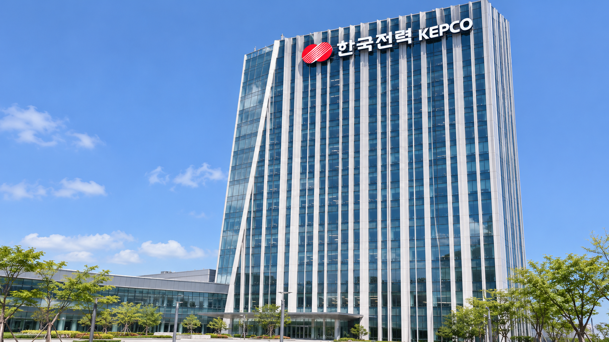
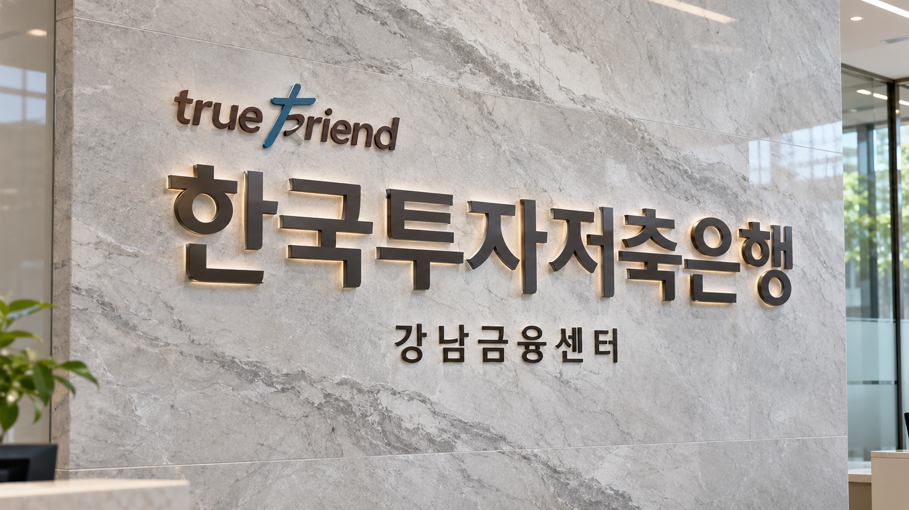
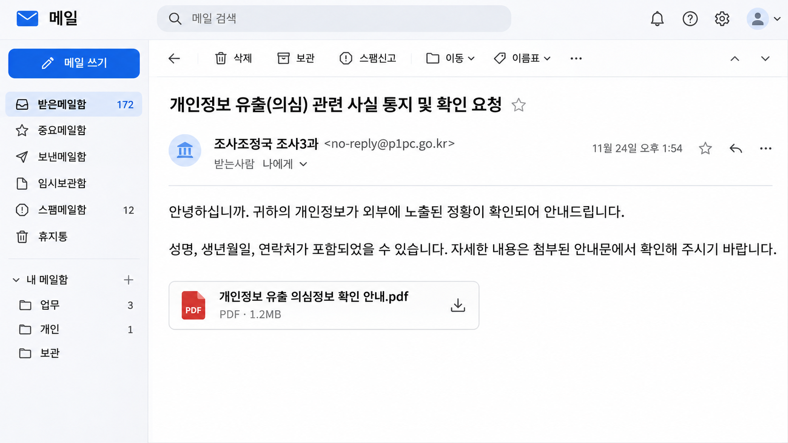
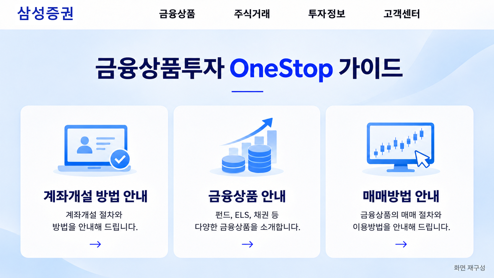

## 한전 고객정보 유출…주민등록번호·계좌·카드정보 포함

한국전력의 고객 서비스 플랫폼 ‘한전ON’과 전자조달시스템(SRM)에서 개인정보 유출 사고가 발생했다. 한전이 11월 22일 발표한 규모는 한전ON 이용자 65만 487명과 전자조달시스템 이용자 86만 9,761명이다. 다만 전자조달시스템의 인원은 개인별 유출 범위를 확정하기 어려워 전체 이용자의 정보가 유출된 것으로 간주한 수치다.

한전ON에서는 고객번호, 고객명, 주민·외국인등록번호, 전화번호, 주소, 은행명, 계좌번호, 예금주명, 카드사, 카드번호, 카드명의자, 요금·청구정보 등 12개 항목이 유출됐다. 전자조달시스템의 대상 정보에는 기업 대표자의 성명·주민 또는 외국인등록번호·이메일·회사 주소와 한전·기업 직원의 성명·소속·사번·연락처 등이 포함됐다. 이용자 유형에 따라 대상 항목은 다르다.

한전은 11월 19일 해커로부터 정보 탈취를 주장하는 이메일을 받았으며, 이튿날 다크웹 게시 사실과 샘플 데이터를 확인했다. 이후 외부 IP 접속을 차단하고 관련 서비스를 중단했다. 개인정보보호위원회는 한전의 유출 신고를 접수한 뒤 23일 조사에 착수했다. 구체적인 침입 경로와 공격 방식은 관계기관이 조사하고 있다.

후속 대책으로 한전은 25일 유출 통지를 받은 고객에게 NICE평가정보의 ‘지키미케어십’ 이용권을 무료로 제공한다고 밝혔다. 이용권에는 불법 신용조회 및 명의도용 본인인증 차단 기능과 피싱·해킹 안심보상 보험이 포함된다. 보험은 약관에서 정한 금융사기로 인한 금전적 손해를 최대 1천만 원까지 보상하며, 이용권 등록 후 1년간 혜택을 받을 수 있다.

한전은 12개 카드사와 유출 고객의 이상거래 감시를 강화하기로 협의했으며, 은행 등 45개 금융기관과도 협의를 진행한다고 밝혔다. 이용자는 한전 공식 안내 페이지에서 유출 대상 여부와 항목을 확인할 수 있다. 전자조달시스템 이용자의 유출 항목은 개별 통지문으로 안내되며, 피해 상담과 접수는 한전 고객센터 123에서 받는다.

## 한국투자저축은행, 두 차례 유출로 고객 8만 6,611명 피해

한국투자저축은행의 모바일 홈페이지에 대한 외부 공격으로 고객 8만 6,611명의 개인정보가 유출됐다. 11월 22일부터 23일 사이 8만 6,433명의 정보가 유출된 데 이어, 25일에도 178명의 정보가 추가로 유출됐다.

첫 번째 유출은 22일 오후 10시 42분부터 23일 오전 3시 35분 사이 발생했다. 은행은 23일 시스템 점검 과정에서 모바일 홈페이지에 비정상적인 외부 접근이 있었다는 사실을 발견했다. 두 번째 유출은 25일 오전 9시 43분부터 10시 2분 사이 확인됐다. 구체적인 공격 수법이나 두 차례 접근에 동일한 취약점이 사용됐는지는 공개되지 않았다.

유출 항목은 고객명, 생년월일, 성별, 휴대전화번호, CI(연계정보) 등 다섯 가지다. CI는 온라인 본인확인 과정에서 동일인 여부를 식별하는 데 쓰이는 정보다. 은행은 이들 다섯 항목 외의 금융거래정보는 유출되지 않았다고 밝혔다.

은행은 사고 인지 후 관련 IP와 불법 접속 경로를 차단하고 해당 서비스 운영을 중단했다고 설명했다. 신규 보안 정책을 적용하고 시스템 모니터링도 강화했다. 아울러 유출 정보를 이용한 보이스피싱과 명의도용에 주의할 것을 당부하며, 개인정보노출자 사고등록과 명의도용 방지 서비스 이용을 권고했다. 개인정보 유출 피해신고센터는 1577-6333이다.

## 개인정보위 사칭 메일…‘유출 사실 확인’ 내세워 악성 PDF 실행 유도

개인정보보호위원회 직원을 사칭해 개인정보 유출 사실을 확인하라며 악성 첨부파일을 열도록 유도하는 메일이 발견됐다. 개인정보위는 11월 24일 이러한 사칭 메일이 유포되고 있다며 주의를 당부했다.

공개된 예시에서 발신자는 ‘조사조정국 조사3과’로 표시됐으며, 발신 주소는 `no-reply@p1pc.go.kr`이었다. 개인정보위 홈페이지 주소인 `pipc.go.kr`의 영문 소문자 ‘i’를 숫자 ‘1’로 바꿔 기관 주소처럼 보이도록 구성했다. 개인정보위가 실제 업무용 메일에 사용하는 도메인은 `korea.kr`이다.

메일 제목은 ‘개인정보 유출(의심) 관련 사실 통지 및 확인 요청’이었다. 본문은 수신자의 성명·생년월일·휴대전화번호 등이 외부에 노출된 정황을 확인했다는 내용으로 작성됐으며, 개인정보 보호법 조항까지 제시했다. 첨부파일은 ‘개인정보 유출 의심정보 확인 안내.pdf’로 표시됐다. 개인정보위는 악성코드가 심어진 첨부파일의 실행을 유도하는 사례라고 설명했다.

개인정보위는 해당 형식의 이메일이나 공문을 발송한 사실이 없다고 밝혔다. 개인정보 유출 통지는 개인정보위가 아닌 실제 유출이 발생한 기관이나 기업이 이용자에게 실시한다. 이번에 공개된 첨부파일의 구체적인 감염 방식과 실제 피해 규모는 발표되지 않았다.

개인정보위는 의심 메일의 링크나 첨부파일을 실행하지 말고, 공식 홈페이지나 앱에 직접 접속해 안내의 진위를 확인할 것을 당부했다. 메일에 적힌 연락처로 확인하거나 피해구제를 명목으로 요구하는 원격제어 앱을 설치해서는 안 된다고 안내했다. 사칭 메일은 경찰청 112 또는 개인정보침해신고센터 118로 신고할 수 있다.

## 삼성증권 ‘고객의 소리’ 첨부파일 유출…8,241명 개인정보 포함

삼성증권 홈페이지의 ‘고객의 소리(VOC)’ 서비스에서 고객이 제출한 첨부파일 일부가 유출됐다. 삼성증권은 11월 21일 오후 해당 서비스에서 비정상적인 외부 접근 흔적을 발견했으며, 조사 결과 고객 8,241명의 개인정보 유출을 확인했다고 23일 밝혔다.

VOC는 고객이 의견이나 민원을 접수하는 창구다. 이번에 유출된 첨부파일에는 이름, 계좌번호, 주소, 연락처, 운전면허번호 등 총 13개 항목의 개인정보가 포함됐다. 파일에 담긴 내용에 따라 고객별 유출 항목은 다르다. 회사는 VOC에 접수된 정보에서만 유출 흔적이 확인됐으며, 해당 서비스를 이용하지 않은 고객과는 무관하다고 설명했다.

삼성증권은 사고를 인지한 뒤 관련 IP를 차단하고 해당 서비스 운영을 중단했다. 금융감독원과 한국인터넷진흥원 등 관계기관에 신고했으며, 다른 시스템에 대한 보안 점검도 진행한다고 밝혔다. 외부에서 VOC 서비스에 접근한 구체적인 수법과 악용된 취약점은 공개되지 않았다.

회사는 유출 고객에게 피해 항목을 개별 통지하고, 홈페이지에 ‘개인(신용)정보 유출 조회’ 기능을 제공한다고 안내했다. 유출 정보를 악용한 보이스피싱과 악성코드 유포 목적의 스팸메일에도 주의를 당부했다. 실제 피해가 확인되면 관련 법령과 내부 기준에 따라 배상 절차를 진행하겠다는 입장이다. 문의와 피해 접수는 삼성증권 패밀리센터 1588-2323과 전담상담센터 02-6230-3930에서 받는다.

## HD현대로보틱스 홈페이지 회원정보 유출…암호화된 비밀번호도 포함

HD현대로보틱스 홈페이지 가입자의 개인정보가 외부로 유출됐다. 회사는 11월 19일 불법적인 외부 접근으로 개인정보가 유출됐으며, 20일 이를 확인했다고 공지했다.

유출 항목은 회원구분, 이름, 아이디, 암호화된 비밀번호, 회사명, 회사 유선번호, 부서명, 직책, 휴대전화번호, 이메일이다. 실제 유출 항목은 회원마다 다를 수 있다. 피해 인원과 구체적인 침입 경로, 악용된 취약점은 공지에 명시되지 않았다.

회사는 공격에 사용된 IP를 차단하고 해당 서버를 격리했으며, 외부 접근 통제와 보안 관제를 강화했다고 밝혔다. 추가적인 비정상 접근 여부도 지속적으로 점검하고 있다. 홈페이지의 ‘개인정보 유출 대상 조회’에서는 이름과 이메일을 입력해 본인의 유출 여부와 항목을 확인할 수 있다.

HD현대로보틱스는 홈페이지와 동일한 비밀번호를 사용하는 다른 업무용·개인용 계정의 비밀번호도 변경할 것을 권고했다. 회사나 거래처를 사칭해 송금, 계좌 변경, 개인정보 제공을 요구하는 연락을 받으면 기존에 알고 있던 연락처로 사실 여부를 확인하라고 안내했다. 의심스러운 전화나 메일 등 피해 관련 문의는 회사 HR팀의 접수 이메일인 `robotics@hd.com`으로 할 수 있다.

*본문 이미지는 실제 사고 현장 사진이 아닌 AI 생성 이미지다.*

## 출처

- 한전 — [개인정보 유출 관련 공식 안내](https://www.kepco.co.kr/home/media/newsroom/notice/boardView.do?boardMngNo=14&boardNo=2822), [개인정보위 조사 착수](https://pipc.go.kr/np/cop/bbs/selectBoardArticle.do?bbsId=BS074&mCode=&nttId=12664), [연합뉴스: 유출 규모와 항목](https://www.yna.co.kr/view/AKR20261122042851003), [연합뉴스: 피해 예방 지원 대책](https://www.yna.co.kr/view/AKR20261125085300003)
- 한국투자저축은행 — [뉴시스: 두 차례 유출 경위](https://nwww.newsis.com/view/NISX20261125_0003883496), [연합뉴스: 사고 발견 경위](https://www.yna.co.kr/amp/view/AKR20261125165600002), [조선일보: 유출 항목과 피해 접수 안내](https://www.chosun.com/economy/economy_general/2026/11/25/2GTFW7TQKJBK3OB4ATBVXRUATA/)
- 개인정보위 사칭 메일 — [개인정보위 보도자료](https://pipc.go.kr/np/cop/bbs/selectBoardArticle.do?bbsId=BS074&mCode=&nttId=12667), [정책브리핑: 사칭 메일 예시](https://www.korea.kr/multi/visualNewsView.do?newsId=148976442)
- 삼성증권 — [연합뉴스: 유출 규모와 피해 범위](https://www.yna.co.kr/view/AKR20261123060700008), [머니투데이방송: 사고 경위와 대응](https://news.mtn.co.kr/article/2026112310513658391), [서울파이낸스: 유출 조회·피해 접수 안내](https://www.seoulfn.com/news/articleView.html?idxno=643608)
- HD현대로보틱스 — [개인정보 유출 공식 안내 및 대상 조회](https://www.hd-hyundairobotics.com/user/check_pop)
