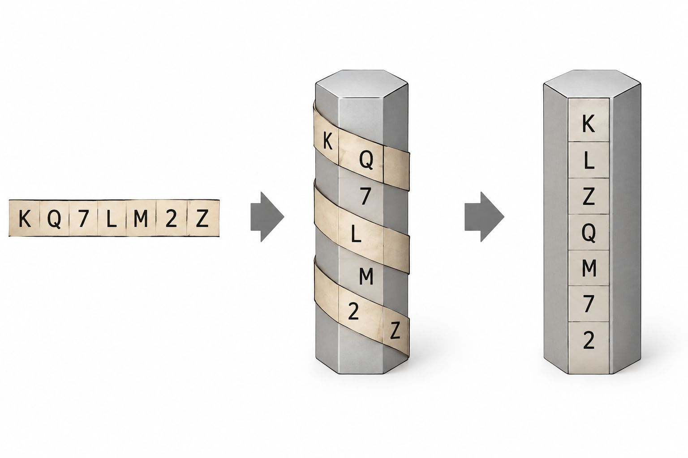

오늘날 사용하는 암호 기술은 아주 고대로부터 시작한다. 우리가 매일 쓰는 HTTPS와 메신저 암호화의 뿌리를 따라가다 보면, 2,000년도 더 전의 막대 하나와 편지 한 장에 닿는다. 고대 스파르타의 스키테일은 글자의 *순서*를 섞었고, 로마 카이사르의 시저 암호는 글자 *자체*를 바꿨다. 이 두 방식은 각각 전치(transposition)와 치환(substitution)이라는 이름으로 지금도 현대 암호 설계의 기본 재료로 쓰인다.

## 스키테일 — 2,500년 전의 세로드립

> **덕**분에 오늘도 과제가 산더미
>
> **큐**(Q)&A 시간만 되면 다들 눈을 피하고
>
> **리**포트 마감은 왜 항상 오늘 자정인지
>
> **티** 안 내려 해도 멘탈은 이미 퇴근했다

구구절절한 대학생의 하루 같지만, 첫 글자만 세로로 읽으면 덕큐리티. 인터넷에서 '세로드립'이라 부르는 이 장난을 고대 스파르타 사람들은 무려 막대 하나로 군사 기밀에 썼다. 바로 스키테일(Scytale)이다.

스키테일은 그리스어로 '막대'라는 뜻으로, 막대를 이용한 전치 암호다. 세로드립이 가로 문장 속에 세로 메시지를 숨긴다면, 스키테일은 반대로 가로로 쓴 메시지를 세로로 흩어 놓는다.

가장 자세한 기록은 1~2세기 그리스 작가 플루타르코스의 『영웅전』 중 「리산드로스 전」에 나온다. 기원전 5세기 말, 스파르타 본국이 전장의 장군에게 명령을 보낼 때 같은 굵기의 막대를 한 쌍씩 나눠 갖고 이를 이용했다는 내용이다. 단어 자체는 기원전 7세기 시인 아르킬로코스의 작품에도 등장한다.

다만 역사학자들 사이에서는 스키테일이 정말 '비밀 유지'용이었는지, 아니면 진짜 본국에서 온 명령인지 확인하는 **인증 수단**에 가까웠는지를 두고 이견이 있다.

## 스키테일의 암호화 방법



원리는 간단하다. 막대의 굵기가 곧 키(key)다.

1. 가죽이나 양피지 띠를 막대에 비스듬히 빈틈없이 감는다.
2. 막대의 길이 방향으로 한 줄씩 평문을 적는다.
3. 띠를 풀면 글자가 뒤섞인 한 줄의 문자열만 남는다. 이것이 암호문이다.
4. 받는 사람은 **같은 굵기의 막대**에 띠를 다시 감아 원문을 읽는다.

예를 들어 둘레에 글자 3개가 들어가는 막대에 `스파르타는오늘밤공격한다`를 한 줄에 네 글자씩 적으면 이렇게 된다.

```txt
스 파 르 타
는 오 늘 밤
공 격 한 다
```

이제 띠를 풀면? 글자가 세로 방향으로 이어져 나온다.

`스는공파오격르늘한타밤다`

누가 봐도 외계어다. 전령이 허리띠처럼 차고 다녀도 아무도 눈치 못 챌 수준. 하지만 같은 굵기의 막대를 가진 장군이 띠를 다시 감는 순간, 세로드립처럼 숨은 문장이 '짠' 하고 나타난다. 글자는 하나도 바뀌지 않고 위치만 바뀌었다 — 이것이 전치 암호의 핵심이다.

## 시저 암호, 카이사르의 비밀 편지

시저 암호(Caesar cipher)는 로마의 정치가이자 장군 율리우스 카이사르(기원전 100~44년)의 이름을 딴 치환 암호다.

로마의 전기 작가 수에토니우스는 『황제 열전』에서 카이사르가 비밀 편지를 쓸 때 알파벳을 순서대로 바꿔, A 대신 네 번째 글자인 D를 쓰는 식으로 적었다고 기록했다. 즉 모든 글자를 세 칸씩 밀어서 쓴 것이다.

같은 책에는 후계자 아우구스투스가 한 칸씩 미는 방식을 썼다는 기록도 남아 있다. 당시 적들 대부분이 글을 읽지 못했고 암호라는 개념 자체가 낯설었기 때문에, 단순한 방식으로도 충분히 효과가 있었던 것으로 보인다.

## 시저 암호의 암호화 방법

```txt
평문:   A B C D E F G H I J K L M N O P Q R S T U V W X Y Z
암호문: D E F G H I J K L M N O P Q R S T U V W X Y Z A B C
```

알파벳을 정해진 칸 수(**키**)만큼 뒤로 밀어 다른 글자로 바꾼다. 끝을 넘어가면 처음으로 돌아온다(X→A, Y→B, Z→C).

키가 3일 때 `ATTACK AT DAWN`은 `DWWDFN DW GDZQ`가 된다. 받는 사람은 반대로 세 칸씩 앞으로 당겨 복호화한다.

알파벳을 0~25의 숫자로 놓으면 수식으로 간단히 표현된다. x는 글자, k는 키다.

```txt
암호화: E(x) = (x + k) mod 26
복호화: D(x) = (x - k) mod 26
```

스키테일과 달리 글자의 위치는 그대로이고 글자 자체가 바뀐다. 키를 13으로 둔 변형은 오늘날 ROT13이라는 이름으로 인터넷에서 스포일러를 가리는 용도로 쓰인다.

## 암호의 한계

두 암호 모두 오늘날의 기준으로는 몇 초 만에 풀린다.

- **전수 조사(브루트포스)**: 시저 암호의 키는 25가지뿐이다. 하나씩 다 대입해 보면 손으로도 금방 원문을 찾는다. 스키테일도 막대 굵기를 바꿔 가며 감아 보면 의미 있는 문장이 나오는 굵기를 찾을 수 있다.
- **빈도 분석**: 9세기 아랍의 학자 알킨디는 언어마다 자주 쓰이는 글자가 정해져 있다는 점(영어라면 E, T, A 순)을 이용해 치환 암호를 푸는 방법을 처음 체계적으로 정리했다. 시저 암호는 글자를 통째로 옮길 뿐이라 이 빈도 분포가 그대로 남는다.
- **키 공유 문제**: 두 방식 모두 보내는 쪽과 받는 쪽이 같은 키(막대, 칸 수)를 미리 나눠 가져야 한다. 키가 새면 모든 통신이 노출된다.

## 오늘날의 의미

두 고대 암호는 깨지기 쉬웠지만, 그 아이디어는 사라지지 않았다. 현대의 대칭키 암호 AES도 내부를 들여다보면 글자(바이트)를 바꾸는 치환 단계와 위치를 섞는 전치 단계를 여러 번 반복하는 구조다. 정보이론의 아버지 클로드 섀넌은 이 두 요소를 각각 '혼돈(confusion)'과 '확산(diffusion)'이라는 원리로 정리했다.

혼돈은 키와 암호문의 관계를 최대한 복잡하게 만드는 것, 확산은 평문의 한 글자가 바뀌면 암호문 전체가 크게 바뀌도록 영향을 퍼뜨리는 것이다. 섀넌이 1949년 논문 「비밀 시스템의 통신 이론」에서 제시한 이 두 원리는 이후 거의 모든 블록 암호의 설계 기준이 됐다.

- **DES (1977년, 미국 표준)**: IBM의 호르스트 파이스텔이 설계한 루시퍼를 바탕으로 만들어졌다. S-box라는 치환표로 혼돈을, 비트 순서를 섞는 순열로 확산을 만들고 이를 16라운드 반복한다.
- **AES (2001년, 미국 표준)**: 벨기에 연구자들이 만든 Rijndael이 공모전에서 뽑혔다. SubBytes 단계가 혼돈을, ShiftRows와 MixColumns 단계가 확산을 맡아 10~14라운드를 돈다. 현재 HTTPS, 와이파이(WPA2·WPA3), 디스크 암호화 등 전 세계에서 가장 널리 쓰이는 암호다.
- **SEED (1999년)와 ARIA (2004년)**: 한국인터넷진흥원과 국내 연구진이 개발한 국산 블록 암호다. SEED는 DES와 같은 파이스텔 구조, ARIA는 AES와 비슷한 치환-순열 구조로 같은 원리를 따르며 공공기관과 금융권에서 쓰인다.

결국 스키테일의 '섞기'와 시저 암호의 '바꾸기'를 수십 번 겹쳐 쌓은 것이 현대 암호의 정체인 셈이다.

또 '키가 노출되면 끝'이라는 고대 암호의 한계는 1970년대 공개키 암호의 등장으로 이어지는 핵심 문제의식이 됐다. 막대 하나와 세 칸의 밀기에서 시작된 고민이 지금도 우리의 메시지를 지키고 있는 셈이다.
