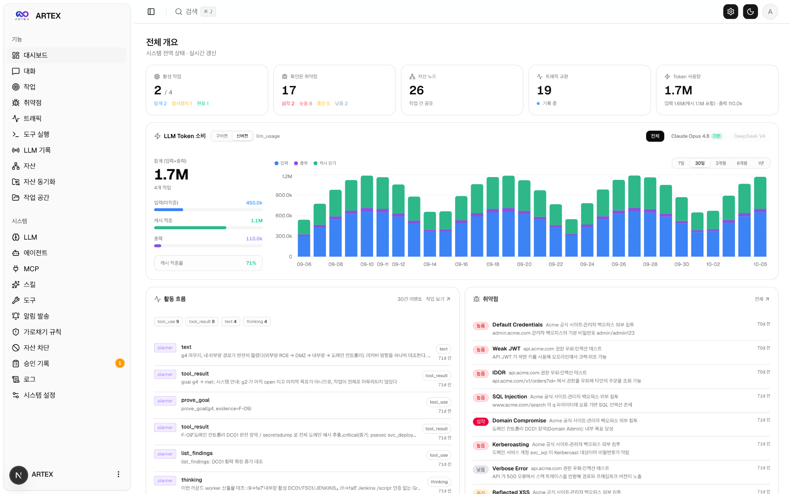
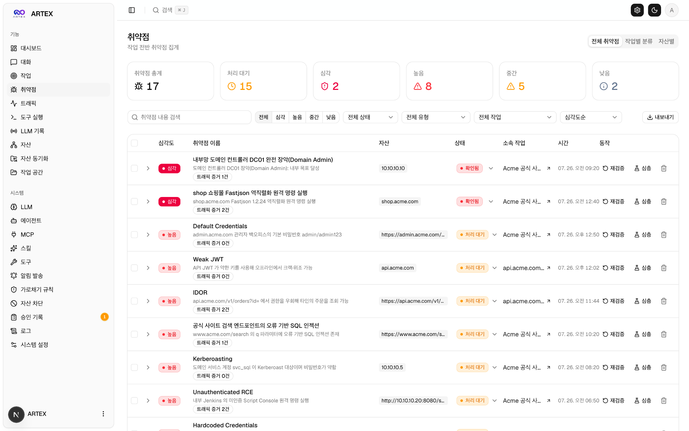
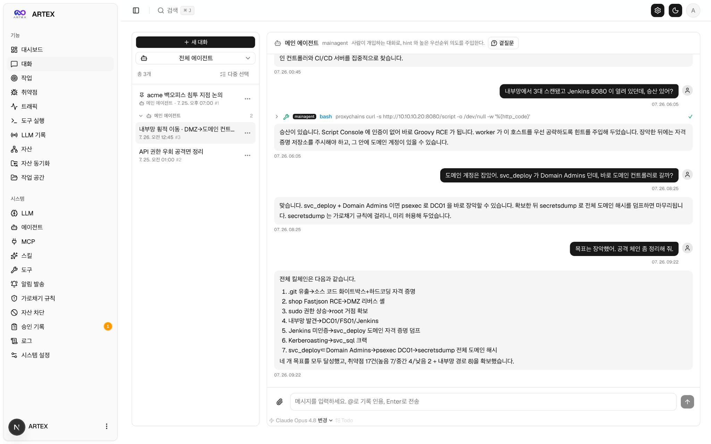

보안 수업에서는 취약점 원리를 읽고, 낯선 명령어를 익히고, 실습이 실패한 이유를 찾는다. 그런데 옆에서는 AI에게 말 몇 마디를 건네면 도구가 움직인다. 이쯤 되면 질문이 생긴다. “AI가 해킹해주는데, 나는 이걸 왜 배우고 있지?”

최근 한국 금융권을 겨냥한 ARTEX 활용 사례는 이 질문을 반대 방향으로 돌린다. AI를 공격에 활용한 것으로 분석된 인프라에서 작업 문서와 대화 기록이 외부에 드러났다. 다른 시스템을 공격하는 도구를 쓴다고 해서, 자신이 쓰는 시스템의 보안까지 저절로 이해하게 되는 것은 아니었다.[^1]

## 챗봇이 도구를 잡으면 달라지는 것

일반적인 챗봇이 답을 만들어준다면, AI 에이전트는 도구의 실행 결과를 받아 다음 작업을 이어갈 수 있다. “무엇을 확인할까?”라는 판단과 명령 실행, 결과 확인이 연결되는 것이다. 침투 테스트는 허가받은 범위에서 공격자의 방법으로 보안 약점을 점검하는 작업이다. 그 도구가 실제 공격에 악용될 수도 있다.

CrowdStrike는 ARTEX를 중국에서 개발된 오픈소스 에이전트형 침투 테스트 도구로 소개하고, 이번 활동에서 대형언어모델(LLM)과 함께 사용됐다고 보고했다. 여기서 곧바로 “AI가 사람 없이 금융기관을 해킹했다”로 건너뛸 수는 없다. 도구 사용의 확인과 전체 공격의 자동화 수준을 입증하는 일은 다르다.[^1]

*ARTEX-KO 공개 저장소의 로컬 격리 샌드박스 데모 화면.[^5] 작업 현황과 모델 사용량 등을 모아 보여준다. 제공된 화면은 이번 공격의 증거 화면이 아니며, 표시된 수치도 공격 성과나 검증된 성능을 뜻하지 않는다.*

대시보드는 작업을 한눈에 정리해주지만, 화면이 깔끔하다고 결과까지 정확해지는 것은 아니다. 취약점 목록도 마찬가지다. 탐지 결과에 ‘심각’이라고 적혀 있더라도, 실제로 어떤 권한에서 문제가 생기는지와 영향을 받는 범위는 확인해야 한다. 보안 원리를 배우는 이유가 바로 이 지점에 있다. 도구가 붙인 이름을 읽는 것과 그 판단의 근거를 설명하는 것은 다른 일이다.

*ARTEX-KO 공개 저장소의 취약점 목록 데모 화면.[^5] 심각도, 자산, 처리 상태 등을 정리하는 모습을 보여준다. 화면 속 항목과 건수는 이번 금융권 공격의 피해 내역이 아니다.*

## 공격을 돕던 문서가 분석의 단서가 됐다

CrowdStrike의 10월 7일 보고서에 따르면, 9월 말부터 10월 초까지 한국 금융기관을 겨냥한 활동과 관련해 데이터 반출이 발생했다. 당시 피해 기관 수는 확인되지 않았다. 보고서가 업계 보도를 인용한 개별 서비스 침해 내용까지 모두 같은 수준으로 직접 검증한 사실처럼 읽어서는 안 된다.[^1]

분석에서 눈에 띄는 것은 공격 활동과 연결된 서버의 공개 디렉터리였다. 외부에서 접근할 수 있었던 `CLAUDE.md`에는 LLM에게 침투 테스트를 지시하는 중국어 프롬프트가 있었고, 홍콩에 위치한 두 번째 서버의 주소도 등장했다. 그 서버에서는 Claude Code 세션 기록, ARTEX 설정, Claude 메모리 파일이 확인됐다.[^1]

`CLAUDE.md`는 Claude Code에 지침을 주는 파일이다. 대화 세션은 요청과 도구 실행의 이력을, 메모리 파일은 재사용할 작업 맥락을 담을 수 있다. 공식 문서는 CLI 대화 기록이 기본적으로 사용자 홈 디렉터리 아래에 프로젝트별로 저장된다고 설명한다. 로컬 저장 자체가 인터넷 공개를 뜻하지는 않는다.[^6]

문서 하나가 다른 서버와 작업 기록을 연결하는 실마리가 된 셈이다. 작업 문서는 목표와 지시 내용을, 세션과 설정은 도구를 사용한 맥락을 살펴볼 자료가 됐다. 다만 공개 보고서에 나온 자료의 연결 관계를, 모든 파일이 발견된 정확한 시간 순서로 바꿔 쓰면 곤란하다. 연결됐다는 사실과 언제 발견됐다는 사실도 구분해야 한다.

여기서 디지털 포렌식이 등장한다. 디지털 포렌식은 파일과 로그 같은 흔적을 수집하고 분석해 무슨 일이 있었는지 재구성하는 작업이다. 위협 인텔리전스는 이런 자료에 인프라와 계정, 공격 방식에 관한 정보를 더해 위협을 이해하고 대응에 활용한다. 둘 다 그럴듯한 이야기를 만드는 일보다, 이야기를 뒷받침하는 근거와 빈칸을 구분하는 일이 중요하다.

## 대화에 이름이 나왔다고 범인일까?

한 세션에는 보안 연구원 이력서를 작성해달라는 요청도 있었다. CrowdStrike는 프롬프트에 담긴 개인정보가 ARTEX 활동을 한 인물과 관련됐을 가능성을 제시했다. 동시에 공개된 정보만으로 해당 정보를 실제 공격자와 확정적으로 연결할 수 없다고 밝혔다.[^1] 분석에 등장한 개인정보를 그대로 퍼 나르는 것보다 이 한계를 함께 전달하는 편이 사건을 정확히 이해하는 데 도움이 된다.

로그프레소는 10월 9일 텔레그램과 GitHub 공개 자료, 과거 인포스틸러 로그를 대조해 계정 간 연결 정황을 제시했다. 이는 공개된 정보를 모아 분석하는 OSINT의 활용이다. 그러나 계정 사이에 연결이 있다는 사실만으로 계정 소유자가 범행을 주도했다고 결론 내릴 수는 없다. 계정을 누가 실제로 사용했는지는 별도로 확인해야 한다.[^2]

연합뉴스의 10월 13일 보도도 경찰이 FBI와 자료 공조를 진행하며, 지목된 계정 인물과 실제 실행자가 다를 가능성을 살피고 있다는 내용이었다. 공개 보도에서 검거 사실은 확인되지 않았다.[^3] “신원 단서를 찾았다”와 “범인을 잡았다” 사이에는 수사와 검증이 남아 있다. 어디까지 확인됐는지를 읽는 것도 분석의 일부다.

## AI에게 맡겨도 서버 권한은 남는다

웹 서버는 파일을 보관하는 곳이면서, 설정에 따라 그 파일을 외부에 제공하는 프로그램이기도 하다. 의도하지 않은 디렉터리 목록이 보이는 문제와, 특정 파일을 외부인이 읽을 수 있는 문제는 서로 관련되지만 같지는 않다. 이번 공개 자료만으로 정확히 어느 설정이 잘못됐는지 단정할 수는 없다.[^1][^4]

방어자라면 “AI를 썼나?”에서 한 걸음 더 나아가야 한다. 작업 기록이 어디에 남는지, 누가 읽을 수 있는지, 외부에 제공되는 경로에 놓이지 않았는지를 확인해야 한다. 명령을 실행할 권한과 기록을 읽을 권한도 함께 살펴야 한다. 이는 AI만의 새로운 원칙이라기보다, 서버 보안에서 배운 접근 권한과 공개 범위의 문제가 AI 작업 환경에도 이어지는 것이다.

*ARTEX-KO 공개 저장소의 대화 데모 화면.[^5] 사용자 요청과 도구 실행 결과를 한 흐름에서 보여준다. 화면 속 대화는 이번 공격의 실제 세션 기록이나 도구의 성공률을 입증하는 자료가 아니다.*

대화창에 완료됐다는 답이 나와도 검증은 끝나지 않는다. 허가된 실습에서도 담당자는 대상과 범위가 맞는지, 결과를 재현할 근거가 있는지, 예상하지 못한 영향이 없었는지를 확인해야 한다. 자연어로 명령할 수 있게 됐다는 편리함이 이 판단까지 대신해주지는 않는다.

## 그래서 무엇을 배우면 될까

네트워크를 배우면 요청이 어디로 갔는지 읽을 수 있다. 운영체제와 서버 권한을 배우면 파일이 왜 노출됐는지 따져볼 수 있다. 웹 취약점을 배우면 탐지 결과의 근거를 검토할 수 있고, 로그 분석을 배우면 실행됐다는 주장과 실제로 남은 흔적을 비교할 수 있다. 지금 배우는 과목들은 도구의 답을 평가할 기준이 된다.

AI가 반복 작업의 부담을 줄이고 일부 작업의 진입장벽을 낮출 가능성은 있다. 그렇지만 이 사례 하나로 공격자의 실력이나 자동화 비율을 수치로 평가할 수는 없다. 이번 사례에서 더 분명한 교훈은 도구를 실행하는 능력과 시스템을 이해하는 능력이 같지 않다는 점이다.

우리가 해킹을 배우는 이유도 명령어를 더 많이 외우기 위해서만은 아니다. 무엇이 취약했고, 어떤 증거가 남았으며, 어디까지 말할 수 있는지 설명하기 위해서다. AI가 작업을 빨리 끝낼수록, 그 ‘완료’를 믿어도 되는지 판단할 사람이 필요하다.

---

## 출처

[^1]: CrowdStrike Intelligence, [Unknown Threat Actor Uses AI-Driven ARTEX to Target South Korean Finance](https://www.crowdstrike.com/en-us/blog/unknown-threat-actor-uses-artex-to-target-south-korean-finance/), 2026-10-07.
[^2]: 로그프레소 CTI, [OSINT를 활용한 ARTEX 캠페인 추가 분석 - 공격 집단 실체 검증](https://logpresso.com/ko/blog/2026-10-09-artex-osint-analysis), 2026-10-09.
[^3]: 연합뉴스, [경찰, 금융권 해킹수사 美 FBI와 공조…공격자 신원·활동 추적](https://www.yna.co.kr/amp/view/AKR20261013093900004), 2026-10-13.
[^4]: MITRE, [CWE-548: Exposure of Information Through Directory Listing](https://cwe.mitre.org/data/definitions/548.html) · [CWE-552: Files or Directories Accessible to External Parties](https://cwe.mitre.org/data/definitions/552.html), 상시 갱신 자료, 열람 2026-10-15.

[^5]: jiwoochris, [ARTEX 한국어판 README 및 데모 화면](https://github.com/jiwoochris/artex-global/blob/bcff914b916e5d085a7821d2abe6af345924c0c2/README.md), 해당 커밋 공개 2026-10-05. 사용자 제공 화면 3장을 삽입했다. README는 로컬 격리 샌드박스의 데모 데이터이며 대상은 가상으로 설정한 acme.com과 사설 대역이라고 명시한다. artex-ko는 현재 artex-global로 연결된다.
[^6]: Anthropic, [Manage sessions](https://code.claude.com/docs/en/sessions#where-transcripts-are-stored) · [How Claude remembers your project](https://code.claude.com/docs/en/memory), 상시 갱신 공식 문서, 열람 2026-10-15. CLI 세션의 기본 로컬 저장과 지침·자동 메모리의 역할을 설명하는 자료이며, 당시 공격 서버의 정확한 저장 경로나 노출 설정을 입증하는 자료는 아니다.
