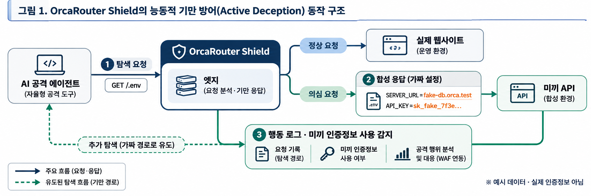

# 공격자를 차단하는 대신 속인다? AI 시대의 능동적 기만 방어 기술

> **OrcaRouter Shield, 자율형 AI 공격 에이전트의 판단을 역이용하는 새로운 보안 전략**

인공지능 기술의 발전은 사이버 공격의 자동화에도 변화를 가져오고 있다. 기존에는 공격자가 직접 웹사이트 구조를 분석하고 취약점을 탐색해야 했다면, 최근에는 AI 에이전트를 활용해 정보 수집부터 공격 경로 탐색, 후속 행동 결정까지 여러 과정을 자동화할 수 있게 됐다.

이러한 변화에 따라 공격 요청을 탐지하고 차단하는 기존 보안 방식과 함께, 공격자가 수집하는 정보를 통제해 공격 과정을 방해하는 기술이 주목받고 있다.

2026년 11월, AI 인프라 기업 OrcaRouter는 자율형 공격 에이전트를 대상으로 한 능동적 기만 방어 서비스 **Shield**를 공개했다. Shield는 공격자가 접근하는 웹 환경에 가짜 파일과 경로, 인증정보를 제공해 잘못된 공격 경로로 유도하고, 그 과정에서 발생하는 행동을 분석하는 기술이다.

## 능동적 기만 방어(Active Deception)

기만 방어는 공격자가 실제 시스템과 가짜 시스템을 구분하기 어렵도록 환경을 구성하고, 공격자의 접근과 행동을 관찰하는 보안 기술이다. 대표적인 방식인 허니팟(Honeypot)은 실제 서버처럼 보이는 가상 환경을 제공해 공격자의 접근을 유도한다.

자율형 AI 공격 에이전트는 탐색 과정에서 발견한 파일, 서버 주소, 인증정보 등을 분석해 다음 행동을 결정할 수 있다. 이러한 특성은 공격자가 수집하는 정보에 의도적으로 잘못된 단서를 포함해 실제 시스템과 관계없는 경로로 유도하는 방어 전략으로 활용될 수 있다.

OrcaRouter Shield는 이러한 접근법을 웹 애플리케이션 환경에 적용한 사례다.

## 합성 환경(Synthetic Environment)

Shield는 웹사이트 앞단의 엣지(Edge)에서 들어오는 요청을 분석하고, 의심스러운 탐색 요청에 실제 데이터 대신 합성된 정보를 제공하도록 설계됐다.

정상적인 방문자는 기존 웹사이트를 이용할 수 있으며, 환경설정 파일이나 소스코드 관리 정보처럼 공격자가 정찰 과정에서 탐색하는 경로에는 별도의 미끼 응답이 제공될 수 있다.

예를 들어 공격자가 웹사이트의 `/.env` 경로에 접근하는 상황을 생각해 볼 수 있다. `.env` 파일은 애플리케이션의 환경변수를 저장하는 데 사용되며, 설정에 따라 데이터베이스 접속정보나 API 키 등이 포함될 수 있다.

Shield는 이러한 요청에 실제 환경설정 파일 대신 가상의 서버 주소와 인증정보가 포함된 설정 파일을 반환할 수 있다. 공격자가 해당 정보를 실제 시스템에서 확보한 단서로 판단하면 파일에 포함된 주소나 API를 추가로 탐색하게 된다.

합성 환경에는 가짜 설정 파일뿐 아니라 소스 맵(Source Map), API 경로 등 여러 형태의 정보가 포함될 수 있다. 서로 연결된 미끼 정보는 공격자가 실제 운영 환경과 무관한 경로를 따라 탐색하도록 유도하는 데 활용된다.

### OrcaRouter Shield 동작 구조

*그림 1. OrcaRouter Shield의 능동적 기만 방어 작동 개념도. 이해를 위해 재구성한 설명 이미지이며 제조사의 공식 아키텍처 도면은 아니다. 그림 속 주소 및 API 키는 가상 예시다.*

그림은 공격 AI의 탐색 요청이 Shield에 전달된 뒤 정상 요청과 의심 요청으로 구분되는 과정을 나타낸다. 정상 요청은 실제 웹사이트로 전달되며, 의심스러운 정찰 요청에는 합성된 파일과 API 경로, 미끼 인증정보가 제공될 수 있다.

공격 에이전트가 미끼 정보를 따라 추가 탐색을 수행하면 방어 시스템은 해당 행동을 기록하고 분석할 수 있다. 이후 미끼 인증정보의 사용이 확인되면 관련 방문자나 요청 출처를 식별하고, WAF와 연계해 대응할 수 있다.

## 추론 맥락 오염(Reasoning Context Contamination)

AI 기반 공격 에이전트는 웹사이트를 탐색하면서 얻은 응답을 분석하고, 발견한 정보를 근거로 다음 작업을 선택할 수 있다. 환경설정 파일에서 데이터베이스 주소를 발견했다면 해당 서버에 접근을 시도하거나, API 경로를 확인했다면 추가적인 요청을 생성하는 방식이다.

Shield는 이러한 의사결정 과정에 가짜 정보를 유입시켜 공격자가 잘못된 탐색 방향을 선택하도록 유도한다.

합성된 환경설정 파일에 존재하지 않는 API 주소와 미끼 인증정보가 포함돼 있다면 공격 에이전트는 이를 분석하고 후속 요청을 생성할 수 있다. 연결된 가짜 경로가 반복적으로 제공되는 상황에서는 실제 취약점과 관계없는 탐색에 시간과 자원을 사용하게 될 가능성이 있다.

이처럼 공격자가 수집한 정보의 신뢰성을 흔들어 후속 행동에 영향을 주는 접근법은 **추론 맥락 오염**으로 설명할 수 있다.

특히 AI 공격 에이전트는 정보를 분석하고 다음 행동을 생성하는 과정에서 모델 추론에 필요한 연산 자원과 토큰을 사용한다. 가짜 경로를 반복적으로 탐색하도록 유도하면 공격에 소모되는 시간과 비용을 증가시키는 효과를 기대할 수 있다.

## 미끼 인증정보와 HMAC

Shield는 공격자의 행동을 식별하기 위한 수단으로 미끼 인증정보(Honeytoken)를 활용한다.

허니토큰은 실제 서비스 접근에 사용되지 않는 가짜 API 키나 인증정보 등을 의미한다. 공격자가 해당 정보를 사용하려고 시도하면 방어자는 미끼 정보에 대한 접근과 사용 흔적을 통해 의심스러운 활동을 식별할 수 있다.

OrcaRouter의 공개 자료에 따르면 Shield는 **HMAC(Hash-based Message Authentication Code)**을 활용해 방문자별로 구분 가능한 미끼 인증정보를 생성한다.

HMAC은 비밀키와 해시 함수를 이용해 데이터의 인증값을 생성하는 암호학적 기술이다. 이를 활용하면 미끼 인증정보에 방문자나 세션을 구분할 수 있는 값을 연결하고, 이후 해당 정보가 사용되는 상황에서 원래 제공 대상을 식별하는 데 활용할 수 있다.

예를 들어 방문자 A와 방문자 B에게 서로 다른 가짜 API 키를 제공했다면, 특정 키의 사용 시도가 발생했을 때 어느 방문자에게 제공된 정보인지 추적할 단서를 확보할 수 있다. 이러한 식별은 방문자나 세션과의 연관성을 확인하는 것이며 실제 공격자의 신원을 확정한다는 의미는 아니다.

## 공격 에이전트 평가

OrcaRouter는 Shield의 방어 효과를 확인하기 위해 ARTEX, Strix, PentestAgent, CyberStrike, Cairn 등 자율형 공격 도구를 대상으로 내부 실험을 수행했다고 발표했다.

| 평가 항목 | 제조사 발표 결과 |
|---|---:|
| 공격 경로 유도율 | 87% |
| 가짜 정보 영향률 | 83% |
| AI 토큰 사용량 | 2.3배 |
| 공격 소요 시간 | 5배 |

공개된 결과는 공격 에이전트가 합성된 정보를 실제 단서로 판단하고 후속 탐색을 수행할 경우 공격에 필요한 시간과 자원이 증가할 수 있음을 시사한다.

**해당 수치는 제조사가 공개한 자체 실험 결과이며, 독립적인 재현 검증이 확인된 것은 아니다.** 실험 환경과 공격 도구 설정, 성공 여부의 판단 기준에 따라 결과가 달라질 수 있으므로 실제 운영 환경에서도 동일한 성능이 보장된다고 해석해서는 안 된다.

## 운영 환경과 대응 체계

Shield는 웹 애플리케이션 앞단의 엣지 환경에서 동작하도록 설계됐으며, 관찰 모드(Observe)와 적용 모드(Enforce)를 구분해 운영할 수 있다.

관찰 모드에서는 의심스러운 요청과 자동화된 탐색 패턴을 수집해 분석한다. 적용 모드에서는 미끼 라우팅을 활성화해 합성 응답을 제공하고 공격자의 후속 행동을 관찰할 수 있다. 수집한 요청 기록과 미끼 인증정보 사용 흔적은 공격 패턴을 분석하는 자료로 활용된다.

WAF와 연동된 환경에서는 미끼 정보를 사용한 것으로 식별된 출처에 대해 차단 정책을 적용할 수 있다. 이러한 운영 방식은 실제 서비스에 적용하기 전에 정상 사용자의 요청이 잘못 분류되지 않는지 확인하고, 점진적으로 방어 기능을 활성화하는 데 도움이 된다.

## 보안적 시사점

자율형 AI 공격 에이전트의 등장은 공격 자동화뿐 아니라 방어 기술에도 새로운 과제를 제시하고 있다.

기존 보안 체계가 비정상적인 요청을 식별하고 접근을 차단하는 데 집중했다면, 능동적 기만 방어는 공격자가 수집하는 정보와 그에 따른 의사결정까지 방어 전략의 대상으로 확장한다.

Shield는 가짜 설정 파일과 API 경로를 이용해 공격자의 탐색 방향을 바꾸고, 미끼 인증정보를 통해 후속 행동을 식별하며, 불필요한 탐색을 유도해 공격 비용을 높이려는 접근법을 보여준다.

기술적 한계도 존재한다. 공격자가 합성 환경을 식별하거나 실제 취약한 경로에 직접 접근하는 경우 기만 방어의 효과가 제한될 수 있다. 정상 요청을 잘못 분류하면 서비스 이용에 영향을 줄 가능성도 있다.

따라서 능동적 기만 방어는 취약점 패치, 접근통제, WAF, 로그 모니터링 등 기존 보안 기술을 대체하기보다 함께 활용하는 보완적 방어 수단으로 이해하는 것이 적절하다.

**AI 시대의 보안은 공격자의 접근을 차단하는 것을 넘어, 공격자가 어떤 정보를 수집하고 이를 바탕으로 어떻게 행동하는지까지 고려하는 방향으로 확장되고 있다.** OrcaRouter Shield는 이러한 변화 속에서 공격자의 정보 수집과 판단 과정을 방어에 활용하려는 기술적 접근을 보여주는 사례다.

---

## 참고 자료

- [OrcaRouter Shield 공식 출시 보도자료 — PR Newswire](https://www.prnewswire.com/news-releases/orcarouter-launches-shield-active-deception-against-autonomous-agents-like-artex-strix-cyberstrike-cairn-and-pentestagent-etc-302946300.html)
- [OrcaRouter Shield 출시 기사 — 뉴스와이어](https://www.newswire.co.kr/newsRead.php?no=1047608)
- [OrcaRouter Shield 기술 소개 — ibl.ai](https://ibl.ai/blog/orcarouter-shield-deception-defense-ai-pentest-agents)
