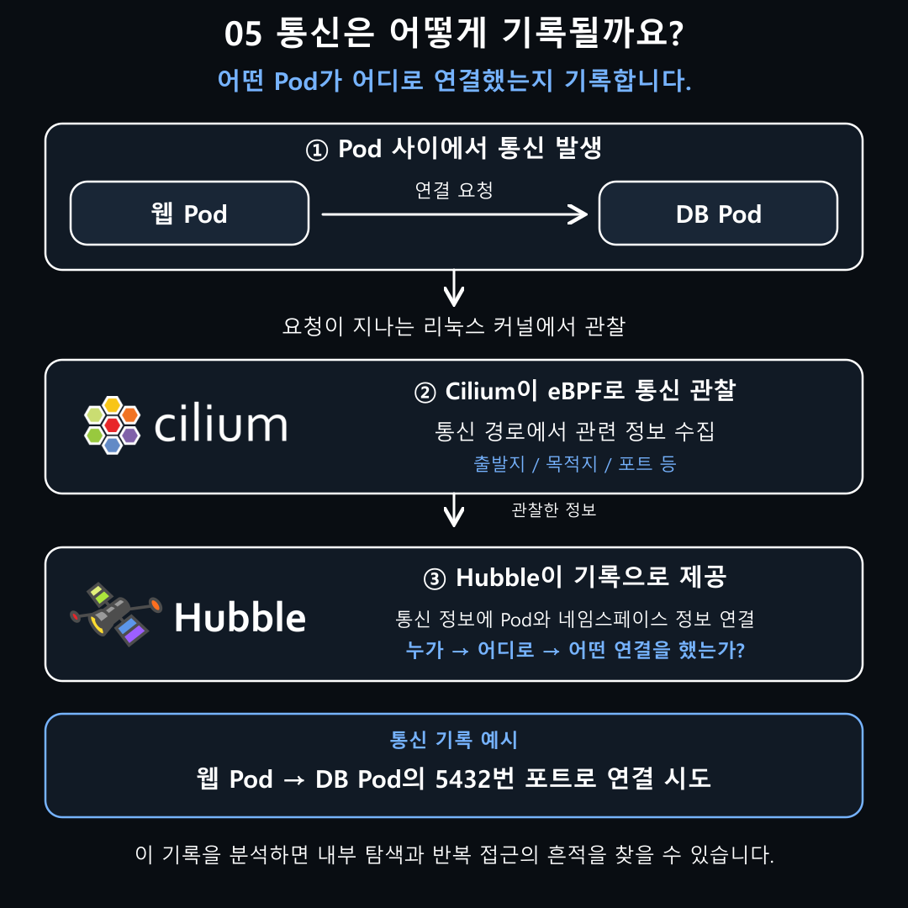
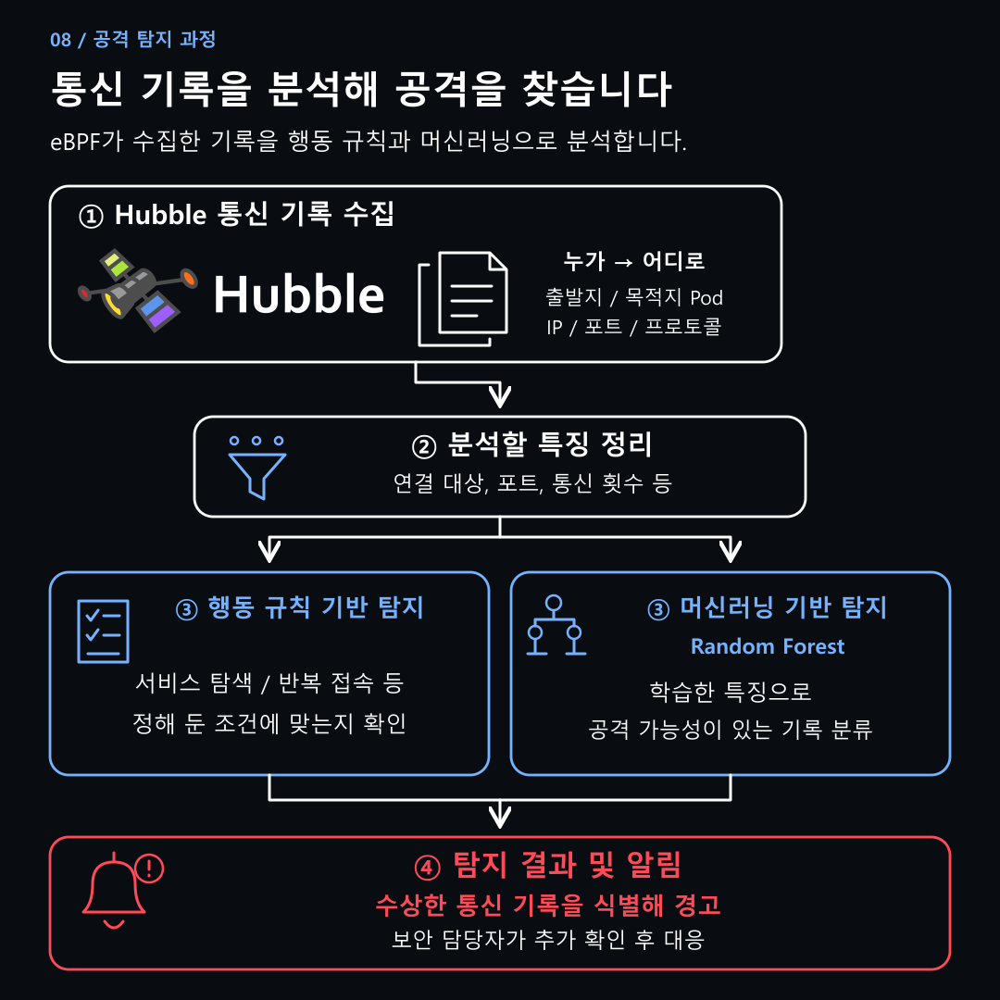
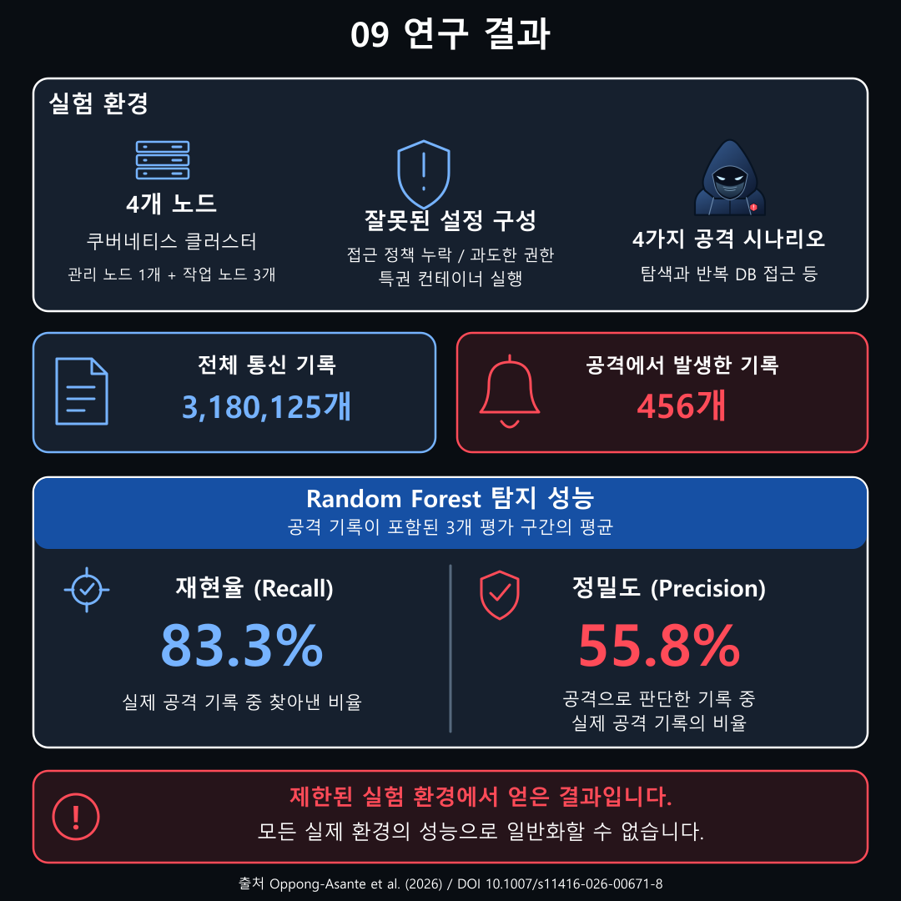

웹 서비스에 침입한 공격자가 다른 내부 서비스로 이동하는 흔적을 네트워크 통신 기록으로 탐지할 수 있다는 연구 결과가 나왔다. 리눅스 운영체제 내부의 활동을 관찰하는 eBPF 기술을 활용한 것으로, 쿠버네티스 환경에서 공격자의 접근 대상과 통신 패턴을 추적하는 데 도움이 될 것으로 보인다.

2026년 9월 26일 국제학술지 ‘Journal of Computer Virology and Hacking Techniques’에 발표된 연구에 따르면, 연구진은 4개 노드로 구성된 쿠버네티스 환경에서 공격을 실행하고 통신 기록을 분석했다. 머신러닝 모델인 Random Forest는 공격 기록이 포함된 세 평가 구간에서 평균 재현율 83.3%, 정밀도 55.8%를 기록했다.

이번 연구가 주목한 것은 침입 이후의 움직임이다. 쇼핑몰 웹 서비스를 장악한 공격자가 주문 처리 서비스와 고객 정보를 저장한 데이터베이스에도 접근하는 상황을 떠올리면 이해하기 쉽다. 내부 접근 통제가 부족하면 공격자는 처음 침입한 서비스를 발판으로 다른 자원을 탐색할 수 있다. 보안 분야에서는 이런 행동을 횡적 이동이라고 부른다.

쿠버네티스는 이러한 서비스가 실행되는 컨테이너의 배포와 확장, 장애 복구를 관리하는 오픈소스 시스템이다. 컨테이너는 프로그램과 실행에 필요한 환경을 함께 담은 상자로 생각하면 된다. 쇼핑몰의 웹 화면과 주문 처리 기능을 각각 운영하고, 주문이 몰리면 처리 기능을 늘리는 식으로 활용할 수 있다.

쿠버네티스에서는 컨테이너가 실행되는 서버를 노드라고 부른다. 각 노드에서는 컨테이너를 하나 이상 묶은 Pod가 실행되며, 여러 노드가 모여 클러스터를 구성한다. 웹 앱이 들어 있는 웹 Pod와 데이터를 저장하는 DB Pod 등이 서로 통신하며 하나의 서비스를 제공하는 구조다.

문제는 서비스를 연결하는 통신 경로가 공격자의 이동 경로로도 사용될 수 있다는 점이다. 공격자가 웹 Pod를 장악하면 접근 가능한 내부 서비스를 찾거나 DB에 반복적으로 연결할 수 있다. 보안 담당자가 이런 움직임을 파악하려면 어느 Pod가 어디에 접근했는지 확인할 수 있어야 한다.

이때 활용할 수 있는 기술이 eBPF다. Pod에서 네트워크 요청이 발생하면 서버의 리눅스 커널이 통신을 처리한다. 커널은 네트워크와 프로세스, 메모리 등 컴퓨터의 핵심 자원을 관리하는 운영체제의 중심 부분이다. eBPF는 커널의 특정 지점에서 작은 프로그램을 실행해 이러한 활동을 관찰하고 관련 정보를 수집할 수 있게 해준다.

쿠버네티스와 eBPF는 이 통신 경로에서 연결된다. 쿠버네티스가 관리하는 Pod의 통신을 커널에서 관찰하고, 수집한 정보에 Pod 정보를 연결하면 어떤 서비스가 어느 서비스에 접근했는지 파악할 수 있다.

연구진은 이를 위해 Cilium과 Hubble을 사용했다. Cilium은 eBPF를 활용해 컨테이너의 네트워크를 처리하는 도구다. Hubble은 Cilium을 바탕으로 통신 정보를 Pod와 연결해 확인할 수 있게 해준다.

예를 들어 웹 Pod가 DB에 연결하면 “웹 Pod가 DB Pod의 5432번 포트에 연결을 시도했다”는 기록을 얻을 수 있다. 포트는 서버에서 어떤 프로그램에 연결할지 구분하는 번호다. 이러한 기록을 모으면 연결 대상과 접속 횟수 등을 분석할 수 있다.

공격자가 내부 서비스를 탐색하면 짧은 시간에 여러 대상으로 연결하는 패턴이 나타날 수 있다. 다른 네임스페이스의 서비스에 접근하거나 같은 DB에 반복적으로 접속하는 행동도 분석할 단서다. 네임스페이스는 쿠버네티스 안의 자원을 프로젝트나 용도에 따라 구분하는 논리적인 구역이다.

연구진은 네트워크 접근 정책 누락과 과도한 권한 부여, 특권 컨테이너 실행 등 잘못된 설정을 실험 환경에 구성했다. 이후 공격 시나리오를 실행하고 Hubble과 eBPF를 활용해 수집한 통신 기록을 행동 규칙과 머신러닝으로 분석했다.

행동 규칙은 내부 서비스 탐색이나 반복 접속처럼 미리 정한 조건에 해당하는 기록을 찾는 방식이다. Random Forest는 통신 특징을 학습해 공격 가능성이 있는 기록을 분류한다. 커널에서 정보를 수집한 뒤 탐지기가 그 기록을 해석하는 과정으로 이어진다.

분석에 사용된 통신 기록은 총 318만125개였다. 이 가운데 공격에서 발생한 것으로 표시된 기록은 456개로, 정상 통신 사이에 적은 수의 공격 기록이 섞여 있었다.

Random Forest의 평균 재현율 83.3%는 실제 공격 기록 가운데 탐지기가 찾아낸 비율을 뜻한다. 평균 정밀도 55.8%는 공격이라고 판단한 기록 중 실제 공격 기록이 차지한 비율이다. 공격 흔적을 상당수 찾아냈지만, 정상 통신을 공격으로 판단하는 오탐도 남았다.

운영 환경에서는 정상적인 점검이나 서비스 호출도 반복적인 연결을 만들 수 있다. 따라서 탐지 결과를 해석할 때는 서비스의 역할과 평소 통신 방식, 접근 대상 등을 함께 확인해야 한다. 이번 성능 수치 역시 제한된 실험 환경에서 얻은 결과로, 규모가 크거나 구성이 다른 환경에서는 추가 검증이 필요하다.

이번 연구는 서비스 사이의 통신을 기록하고 분석하는 것이 침입 이후의 대응에도 도움이 될 수 있음을 보여준다. 공격자가 어느 서비스에 접근했는지 파악하면 확인이 필요한 대상을 좁히고, 접근 정책을 점검하는 데 활용할 수 있다. 쿠버네티스 내부에서 일어나는 연결을 보안 담당자가 읽을 수 있는 공격의 단서로 바꾸는 것이다.

**연구 원문:** [Runtime detection of attacks and misconfigurations in cloud-native Kubernetes environments using eBPF network telemetry](https://doi.org/10.1007/s11416-026-00671-8)

**실험 코드 및 데이터 안내:** [연구 재현용 공개 저장소](https://github.com/Bernard2468/k8s-ebpf-runtime-detection)

**기술 참고:** [Cilium과 Hubble 공식 설명](https://docs.cilium.io/en/stable/overview/intro/)
