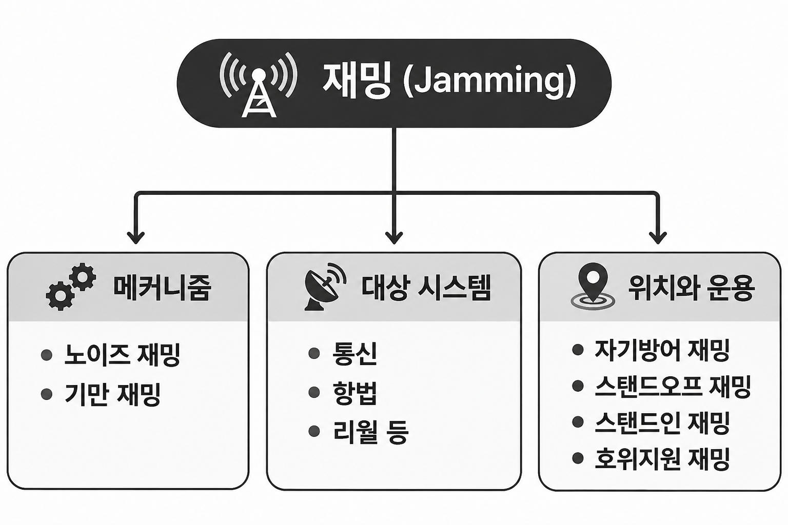
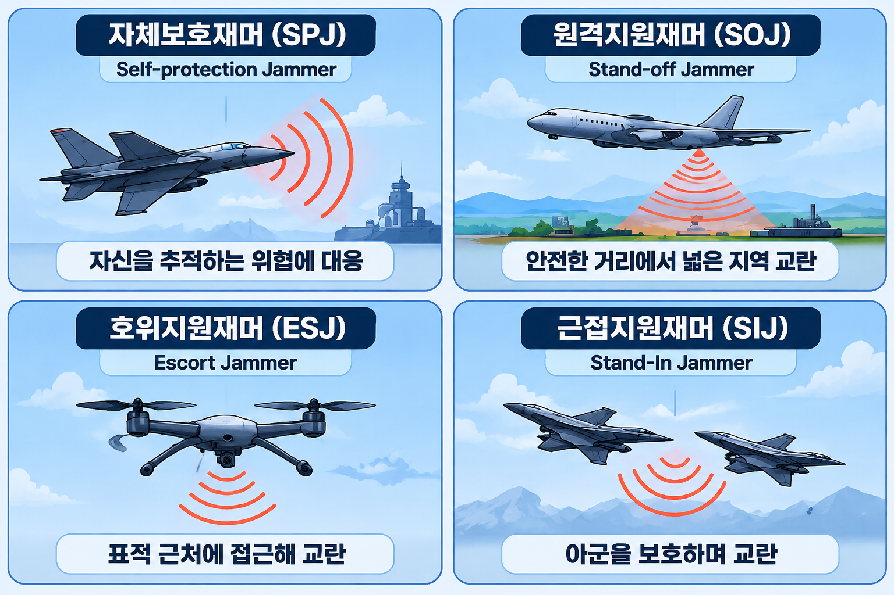

최근 시험장에서 몰래 AI를 이용하여 문제를 푸는 행위에 대한 이슈가 있었다. 이 이야기를 듣고 어떻게 하면 막을 수 있을지 방법을 생각하다가 재밍 기술에까지 다다르게 되었다.

재밍은 무엇일까?

재밍을 이해하기 위해 구글링을 해보면 노이즈 재밍(Noise Jamming), 거리 기만(RGPO), 속도 기만(VGPO), 스푸핑(Spoofing), Deauthentication(Deauth) 공격 등 다양한 용어가 등장한다. 이 모든 게 재밍 기술이지만 재밍이 무엇인지에 대한 또렷한 정답은 되지 않는다. 그뿐만 아니라 이것들은 실제로 작동 원리와 공격 대상, 운용 방식에서 차이가 있어 더더욱 난해해진다.

따라서 재밍에 대한 자료를 찾아보았다. NATO의 AAP-06과 미국 국방부의 JP 1-02에서는 전자 재밍을 **적대적 전자 장치의 효과를 저해할 목적으로 전자기 에너지를 의도적으로 방사·재방사·반사하는 행위**로 포괄적으로 정의한다고 한다.

이 정의는 재밍의 목적과 본질을 설명하지만, 개별 기술이 어떤 원리로 작동하고 어떻게 구분되는지까지 알려주지는 않는다. 이는 재밍의 세부 분류가 하나의 공식적인 분류 체계로만 정리되는 것이 아니라, 전자전 및 통신 분야에서 서로 다른 기준을 적용해 설명하기 때문이다.

따라서 재밍을 조금 더 체계적으로 이해하기 위해 세 가지 관점으로 나누어 살펴보고자 한다.

## 1. 재밍을 구분하는 세 가지 기준

재밍은 크게 메커니즘(Mechanism), 대상(Target), 위치 및 운용 방식(Employment)이라는 세 가지 축으로 이해할 수 있다.

- **메커니즘:** 어떤 원리로 상대 시스템을 교란하는가?
- **대상:** 어떤 전자 시스템을 공격하는가?
- **위치 및 운용 방식:** 재머는 어디에서, 어떤 형태로 운용되는가?

이 세 가지 기준은 서로 독립적이다. 예를 들어 GPS를 대상으로 노이즈 재밍을 수행하더라도, 지상에서 원거리 교란을 시도하는지 드론을 이용해 표적 가까이에서 교란하는지에 따라 운용 방식은 달라진다.

## 2. 메커니즘: 신호를 숨길 것인가, 정보를 속일 것인가?

재밍의 작동 원리를 이해할 때 가장 먼저 구분해야 할 것은 노이즈 재밍과 기만 재밍이다. 두 기술의 차이는 단순하다. 상대방이 신호를 제대로 받지 못하게 만드는 것인지, 잘못된 신호를 진짜라고 믿게 만드는 것인지에 있다.

### 2-1. 노이즈 재밍(Noise Jamming)

노이즈 재밍은 **수신기가 정상적인 신호를 검출하고 처리하지 못하도록 인위적인 잡음을 발생**시키는 방식이다.

무선 통신은 기본적으로 신호 대 잡음비(SNR, Signal-to-Noise Ratio)에 영향을 받는다. 수신 신호의 세기에 비해 잡음이 커질수록 원하는 신호를 구분하기 어려워진다. 노이즈 재밍은 바로 이 원리를 이용해 수신기의 잡음 수준을 인위적으로 높인다.

대표적인 특징은 다음과 같다.

- 재밍 신호가 강해지면 수신기의 AGC(Automatic Gain Control)가 입력 신호의 전체적인 증폭률을 조절하면서 정상 신호의 수신 성능도 저하될 수 있다.
- 수신기는 잡음과 실제 신호를 구분하기 어려워지며, 결과적으로 통신 품질이나 신호 검출 성능이 떨어진다.
- 재밍 신호를 특정 주파수에 집중하는 Spot 방식, 넓은 주파수 대역에 분산하는 Barrage 방식, 주파수 범위를 순차적으로 이동하는 Sweep 방식 등 다양한 형태가 존재한다.
- GPS처럼 수신되는 위성 신호가 매우 약한 시스템은 상대적으로 작은 간섭에도 영향을 받기 쉽다. 반면 Wi-Fi처럼 가까운 거리에서 강한 신호를 주고받는 환경은 상대적으로 높은 간섭 내성을 보일 수 있다.

이처럼 노이즈 재밍은 특정 프로토콜이나 신호 처리 알고리즘을 직접 공략하기보다는, 신호와 잡음의 관계를 이용하는 방식이다. 따라서 다양한 무선 시스템에 적용될 수 있다는 특징이 있다.

### 2-2. 기만 재밍(Deception Jamming)

노이즈 재밍이 정상적인 신호를 수신하지 못하도록 방해하는 방식이라면, 기만 재밍은 **수신기가 잘못된 정보를 정상적인 정보로 받아들이도록 유도**하는 방식이다.

즉, 신호를 단순히 차단하는 것이 아니라 수신기의 신호 처리 및 추적 알고리즘을 역이용한다.

대표적인 사례는 다음과 같다.

- **RGPO(Range Gate Pull-Off):** 레이더의 거리 추적 게이트를 실제 표적의 위치에서 벗어나도록 유도하는 거리 기만 기법이다.
- **VGPO(Velocity Gate Pull-Off):** 레이더의 도플러 및 속도 추적 기능을 교란해 실제 표적과 다른 속도를 추적하도록 만드는 기법이다.
- **GNSS Spoofing:** 위성항법 수신기가 실제 위성 신호가 아닌 위조된 신호를 정상적인 위성 신호로 인식하도록 유도한다.
- **Deauthentication 공격:** Wi-Fi의 관리 프레임을 악용해 특정 기기의 연결을 끊는 방식이다. 순수한 전파 잡음을 발생시키는 노이즈 재밍과 달리 프로토콜의 동작을 악용한다는 점에서 구분할 필요가 있다.

기만 재밍은 노이즈 재밍과 달리 대상 시스템의 내부 동작에 대한 이해가 중요하다. 레이더의 거리 및 속도 추적 알고리즘, GNSS의 신호 동기화 과정, Wi-Fi의 인증 및 연결 관리 절차처럼 각 시스템의 특성을 파악해야 효과적으로 이해할 수 있다.

따라서 기만 재밍은 노이즈 재밍보다 대상 시스템에 대한 전문적인 지식이 요구되는 경우가 많다.

### 2-3. 재밍은 어떻게 탐지하고 방어할까?

재밍은 발생 원리에 따라 탐지 방법과 방어 전략도 달라진다.

**노이즈 재밍 탐지**에서는 주변 전파 환경과 수신 품질의 변화를 관찰하는 것이 중요하다.

- 스펙트럼 모니터링을 통한 잡음 플로어 상승 확인
- 패킷 전달률(PDR) 감소 및 CRC 오류율 증가
- RSSI 등 수신 신호 지표의 비정상적인 변화
- GPS의 C/N₀(Carrier-to-Noise Density Ratio) 감소, AGC 변화 및 수신 위성 수 감소

**기만 재밍 탐지**에서는 단순히 신호의 세기만 확인해서는 충분하지 않다. 수신기가 받아들인 정보가 실제 환경과 일치하는지 검증해야 한다.

- 레이더의 거리 및 속도 추적 결과에서 비정상적인 불일치 확인
- GNSS 수신 위치와 관성항법장치(INS)의 위치 정보 비교
- 복수 수신기 또는 여러 위성 신호 사이의 일관성 검증
- 신호 인증 및 위조 여부를 확인할 수 있는 보안 메커니즘 활용

방어 역시 여러 방법을 조합한다. 주파수 호핑(FHSS)이나 대역확산(DSSS)은 간섭에 대한 내성을 높일 수 있으며, 지향성 안테나와 빔포밍 기술은 특정 방향에서 유입되는 간섭을 억제하는 데 활용된다. 오류정정코드(FEC)는 일부 손상된 데이터를 복구하는 데 도움을 준다.

GPS와 같은 항법 시스템에서는 GNSS 신호만을 신뢰하기보다 INS 등 다른 항법 수단과 결합하는 것이 중요하다. 기만 신호에 대한 대응에는 신호 인증, 복수 안테나를 이용한 방향 분석, 위성 신호 간 일관성 검증 등이 활용된다.

결국 노이즈 재밍에는 신호 품질과 간섭 자체를 관리하는 접근이, 기만 재밍에는 수신 정보의 신뢰성을 검증하는 접근이 중요하다고 볼 수 있다.

## 3. 대상: 재밍은 어떤 시스템을 공격하는가?

재밍은 특정 통신 장치에만 적용되는 기술이 아니다. 레이더부터 항법 장치, 미사일 유도 시스템까지 다양한 전자 시스템이 공격 대상이 될 수 있다.

미국 국방부의 전자전 관련 교재인 DTIC ADA130536에서는 전자전의 주요 표적 시스템을 다음과 같이 아홉 가지로 구분한다.

1. **표적 탐지 시스템(Target Detection Systems):** 주변의 물체나 위협을 탐지하는 시스템
2. **표적 추적 시스템(Target Tracking Systems):** 탐지된 표적의 거리와 속도 등을 지속적으로 추적하는 시스템
3. **지대공 무기발사 시스템(Surface-to-Air Weapon Delivery Systems):** 지상에서 공중 표적을 공격하기 위한 무기 운용 시스템
4. **공대공 무기발사 시스템(Air-to-Air Weapon Delivery Systems):** 항공기에서 공중 표적을 공격하기 위한 무기 운용 시스템
5. **미사일 호밍 및 퓨즈 시스템(Missile Homing and Fuse Systems):** 미사일의 표적 추적 및 폭발 시점을 제어하는 시스템
6. **지상 통제 요격 체계(Ground Controlled Intercept Systems, GCI):** 지상에서 항공기의 탐지와 요격을 통제하는 시스템
7. **통신 시스템(Communication Systems):** Wi-Fi, 셀룰러, 군용 무전기 등 정보를 송수신하는 시스템
8. **항법 시스템(Navigation Systems):** GPS 및 GNSS와 같이 위치와 이동 정보를 제공하는 시스템
9. **전자전 시스템(Electronic Warfare Systems):** 전자전 수행에 사용되는 장비와 시스템 자체

여기서 중요한 점은 동일한 재밍 기술이라도 공격 대상에 따라 작동 방식과 요구되는 기술적 이해가 달라진다는 것이다.

예를 들어 통신 시스템에 노이즈 재밍을 적용하면 데이터 송수신 품질이 저하되지만, 레이더에 기만 재밍을 적용하면 실제 표적의 거리나 속도를 잘못 판단하게 만들 수 있다.

즉, 재밍을 이해할 때는 단순히 어떤 기술을 사용하는지만 볼 것이 아니라, 해당 기술이 어떤 시스템을 대상으로 하는지도 함께 살펴봐야 한다.

## 4. 위치와 운용 방식: 재머는 어디에서 작동하는가?

마지막으로 살펴볼 기준은 재머의 위치와 운용 방식이다. 동일한 재밍 기술이라도 재머가 어디에 배치되고 어떤 역할을 수행하는지에 따라 운용 형태가 달라진다.

대표적인 방식은 다음과 같다.

- **자체보호 재밍(Self-Protection Jamming, SPJ):** 재머가 자신을 향하는 위협에 직접 대응하는 방식이다. 예를 들어 적의 레이더에 추적되는 전투기가 자체 재밍 장비를 이용해 레이더의 탐지 및 추적을 방해하는 경우가 해당한다.
- **원격지원 재밍(Stand-off Jamming):** 위협 시스템의 작전 범위 밖에서 강력한 재밍 신호를 보내 넓은 지역의 전자 시스템을 교란하는 방식이다.
- **근접지원 재밍(Stand-in Jamming):** 소형 재머 등을 위협 시스템 가까이에 배치해 비교적 짧은 거리에서 교란 효과를 발생시키는 방식이다.
- **호위지원 재밍(Escort Jamming):** 공격 편대와 함께 이동하면서 적의 탐지 및 추적 시스템을 교란해 아군 항공기의 작전을 지원하는 방식이다.

이러한 운용 방식은 앞서 살펴본 메커니즘이나 공격 대상과 별개의 기준이다.

예를 들어 GPS를 대상으로 하는 노이즈 재밍은 지상에서 원거리 교란을 시도하는 스탠드오프 방식으로 운용될 수도 있고, 드론 등에 재머를 탑재해 특정 지역 가까이 접근시키는 스탠드인 방식으로 운용될 수도 있다.

따라서 재밍의 종류를 구분할 때는 어떤 신호를 어떻게 교란하는지뿐 아니라, 재머가 어떤 위치에서 어떤 임무를 수행하는지도 함께 고려해야 한다.

## 5. 재밍의 법적·윤리적 문제

재밍은 단순히 무선 통신을 방해하는 기술을 넘어 실제 사회 기반 시설과 안전에 영향을 줄 수 있는 기술이다.

특히 GPS 재밍은 항공기와 선박의 위치 및 항법 정보에 영향을 줄 수 있으며, 통신 재밍은 긴급 구조나 공공 안전에 필요한 통신까지 방해할 가능성이 있다.

국내에서는 전파법 제58조의2에 따라 적합성평가를 받지 않은 전파 차단 장치 등의 제조·수입·판매·사용이 제한되며, 재머의 운용 역시 관련 법령에 따른 규제를 받는다. 따라서 개인이 임의로 재머를 제작하거나 운용해서는 안 된다.

교정시설의 통신 제한 장치나 드론 대응(C-UAS) 시스템과 같이 특수한 목적의 재밍 장비는 관련 법령과 허가 절차에 따라 제한적으로 운용되는 사례다.

재밍은 전자전 및 보안 분야에서 중요한 기술이지만, 그 영향 범위가 주변의 정상적인 통신 시스템까지 확대될 수 있다는 점에서 기술적 이해와 함께 법적·윤리적 고려가 필요하다.

처음 재밍을 검색했을 때는 서로 다른 기술들이 하나의 개념 안에 뒤섞여 있어 무엇이 무엇인지 구분하기 어려웠다. 하지만 이를 메커니즘, 대상, 위치 및 운용 방식이라는 세 가지 관점으로 나누어 살펴보니 각각의 기술이 어떤 차이를 가지고 있는지 조금 더 명확해졌다.

결국 재밍은 단순히 전파를 방해하는 행위만을 의미하지 않는다. 상대방이 신호를 수신하지 못하게 만들거나, 잘못된 정보를 받아들이도록 유도하고, 특정 시스템의 기능을 제대로 수행하지 못하게 만드는 다양한 전자적 교란 행위를 포괄하는 개념이다.

**참고문헌**

1. [Electronic Warfare and Radar Systems Engineering Handbook](https://apps.dtic.mil/sti/tr/pdf/ADA617071.pdf) — NAWCWD TP 8347. 전자전 및 레이더 시스템의 원리와 재밍 분류 참고
2. [Electronic Warfare 교재의 9개 Target Systems](https://apps.dtic.mil/sti/tr/pdf/ADA130536.pdf) — DTIC ADA130536. 전자전 표적 시스템 분류 참고
3. [Advances in Anti-Deception Jamming Strategies for Radar Systems: A Survey](https://arxiv.org/pdf/2503.00285) — 2025. 레이더 기만 재밍 및 대응 기술
4. [Recent Advances on Jamming and Spoofing Detection in GNSS](https://www.ncbi.nlm.nih.gov/pmc/articles/PMC11244045/) — Sensors, 2024. GNSS 재밍 및 스푸핑 탐지 기술
5. [A Survey of GNSS Spoofing and Anti-Spoofing Technology](https://doaj.org/article/6930b354e394411097be93704cd398f8) — Remote Sensing, 2022. GNSS 스푸핑 및 방어 기술
6. [Survey on Intentional Interference Techniques of GNSS Signals and Radio Links between UAV and GCS](https://www.transnav.eu/files/Survey_on_Intentional_Interference_Techniques_of_GNSS_Signals_and_Radio_Links_between_Unmanned_Aerial_Vehicle_and_Ground_Control_Station,1577.pdf) — GNSS 및 UAV 통신 간섭 기술
7. [An Overview to Electronic Attack and the Jamming Classifications](https://www.skyradar.com/blog/an-overview-to-electronic-attack-and-the-jamming-classifications) — SkyRadar, 2023. 전자 공격 및 재밍 분류 개요
