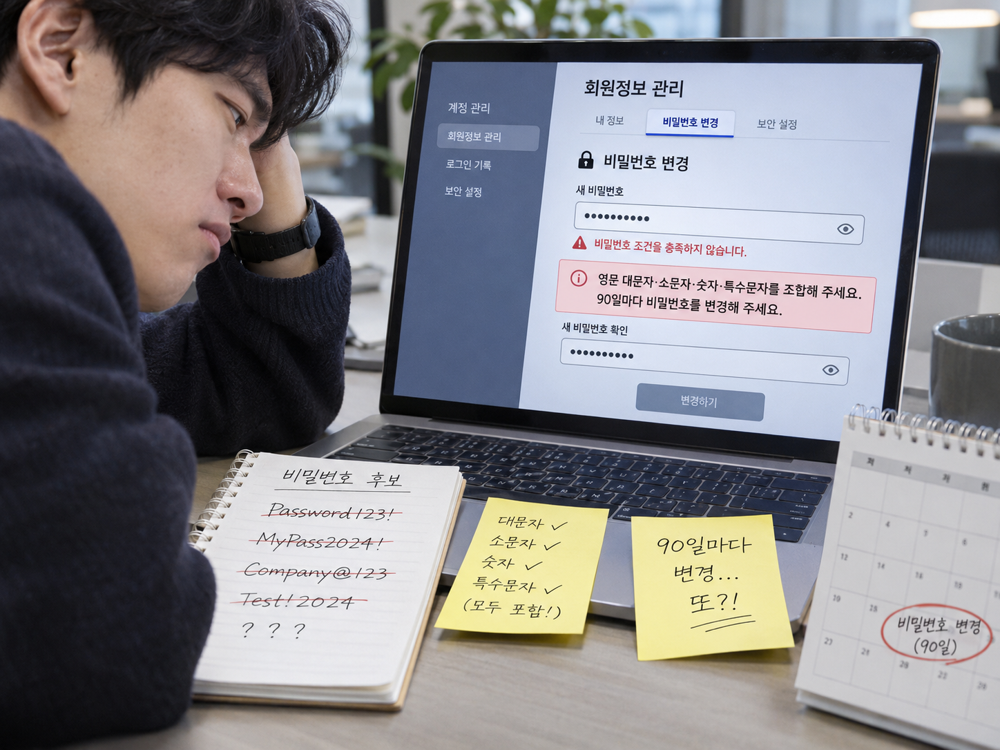
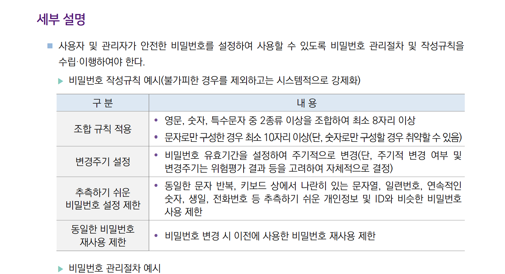
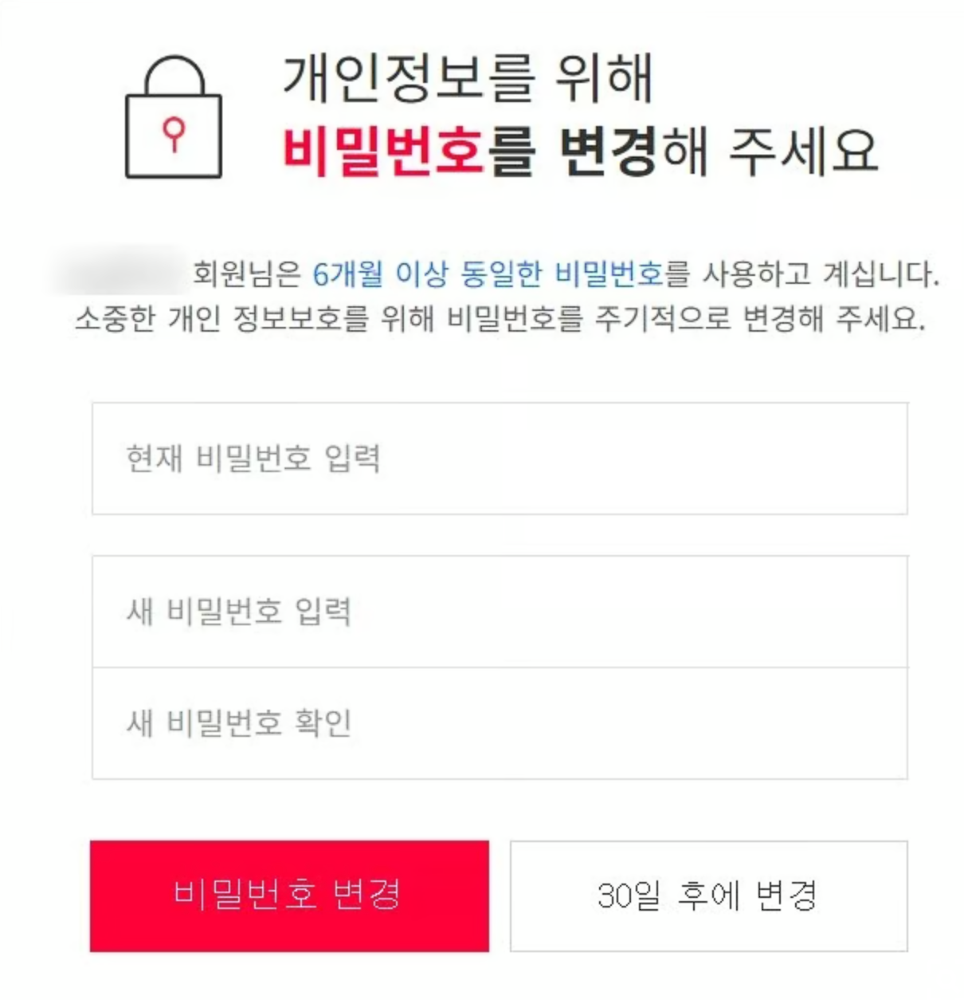
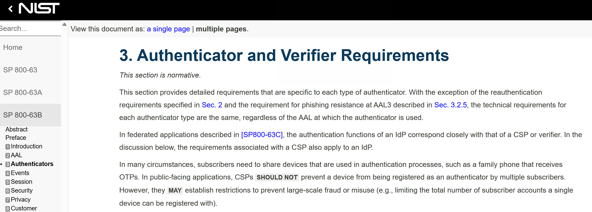

회원가입을 하려는데, 비밀번호부터 똥개훈련이다.

대문자를 넣으란다. 소문자도 있어야 하고, 숫자와 특수문자까지 챙겨야 한다. 조건 하나라도 빠지면 가입 버튼은 꿈쩍도 하지 않는다. 그렇게 겨우 통과했더니, 이번에는 90일 뒤에 다시 바꾸란다.

서비스에 가입하는 건지, 비밀번호 작문 시험을 보는 건지 모르겠다.

그런데 여기서 의문이 하나 생긴다.

**이렇게 열심히 만든 비밀번호, 정말 그만큼 안전할까?**

문제는 비밀번호를 잘 만드는 일 자체가 아니다. **복잡한 규칙을 통과하는 것과, 공격자가 알아내기 어려운 비밀번호를 만드는 것은 다르다**는 것이다. NIST 역시 문자 조합 규칙이 기대만큼의 보안 효과를 내지 못하면서 사용자의 부담은 크게 늘릴 수 있다고 설명한다.

그렇다면 이런 규칙은 왜 있는 걸까? 먼저 인증 기준과 내부 보안 정책이라는, 이른바 ‘어른의 사정’부터 들여다보자.

## 1. ISMS

국내에서는 **정보통신서비스 부문의 전년도 매출액이 100억 원 이상인 사업자** 등 일정 기준에 해당하면 ISMS 인증을 받아야 한다.

ISMS는 코드를 한 번 검사하고 도장을 찍어주는 제도도 아니다. 조직이 보안 정책, 인력, 시스템, 시설 등을 적절하게 관리하는지, 그 관리체계가 인증기준에 맞는지를 심사한다.

여기에는 비밀번호 관리도 포함된다. KISA의 **2023년 11월 ISMS-P 인증기준 안내서**에는 영문·숫자·특수문자의 조합과 변경주기 설정 등이 비밀번호 작성규칙의 예시로 제시돼 있다.

즉, 개발자들은 심사위원들과 WWE 하기 싫기 때문에 저대로 만들 수 밖에 없는것이다.

## 2. 그래도 보안에 좋은거 아님?

양심에 손을 얹고 생각해 보자.

비밀번호 변경 안내가 뜰 때마다 정말 고심 끝에 완전히 새로운 비밀번호를 만드는가? 그리고 그 과정을 몇 달마다 성실하게 반복하는가?

혹시 고민보다 먼저 ‘30일 후에 변경’ 버튼을 찾고 있지는 않은가. 막상 바꾸더라도 끝의 느낌표를 물음표로 바꾸거나, 숫자 하나만 올리고 있지는 않은가.

## 3. NIST도 그러지 말랍니다.

미국 국립표준기술연구소(NIST)도 2025년 발표한 SP 800-63B-4에서 비밀번호 정책에 대한 명확한 기준을 제시했다.

해당 지침의 3.1.1.2절에서는 **영문 대·소문자, 숫자, 특수문자의 조합을 강제하지 말 것**과 **비밀번호를 주기적으로 변경하도록 요구하지 말 것**을 명시하고 있다.

그 이유는 간단하다. 복잡한 규칙을 강제하면 사용자는 예측 가능한 비밀번호를 만들기 쉽고, 주기적인 변경을 요구하면 기존 비밀번호의 숫자만 바꾸는 방식으로 대응할 수 있기 때문이다.

## 4. 사실 로그인 같은거 맨날 할 필요 없음

과거에는 사용자의 로그인 상태를 짧게 유지하고, 일정 시간이 지나면 다시 비밀번호를 입력하도록 하는 방식이 보안을 강화하는 수단으로 활용됐다.

하지만 현대 웹서비스에서는 무조건적인 재로그인보다 안전한 세션 관리와 위험 기반 재인증이 중요해지고 있다.

NIST는 2025년 발표한 SP 800-63B-4에서 인증정보를 지속적으로 제출하도록 요구하는 것보다 세션 관리가 바람직하다고 설명한다.

실제로 OAuth 2.0 환경에서는 Access Token과 Refresh Token을 활용해 사용자가 매번 비밀번호를 입력하지 않고도 인증 상태를 유지할 수 있다.

그렇다고 재인증이 불필요해진 것은 아니다. OWASP는 새로운 기기에서의 로그인, 의심스러운 활동, 비밀번호 변경, 민감한 작업 등 위험도가 높은 상황에서 재인증하도록 권고한다.

**중요한 것은 사용자가 얼마나 자주 비밀번호를 입력하느냐가 아니라, 서비스가 언제 사용자를 다시 확인해야 하는지 정확하게 판단하는 것이다.**

## 5. 만약에 핸드폰 뺏기면 어떡하죠?

비밀번호를 길게 만들고, 서비스마다 다르게 설정하고, 다중요소 인증(MFA)까지 켰다. 이제 안심해도 될까?

심지어 잠금이 풀린 채 로그인된 휴대폰을 통째로 빼앗긴다면?

아무리 강력한 비밀번호와 인증 시스템도 물리적인 위협까지 완벽하게 막아주지는 못한다.

그렇다면 우리가 할 수 있는 최후의 보안 대책은 무엇일까?

**바로 강도에게 휴대폰을 빼앗기지 않을 강인한 육체를 만드는 것이다.**

**비밀번호만 강하게 만들지 말고, 당신도 강해져라.**
