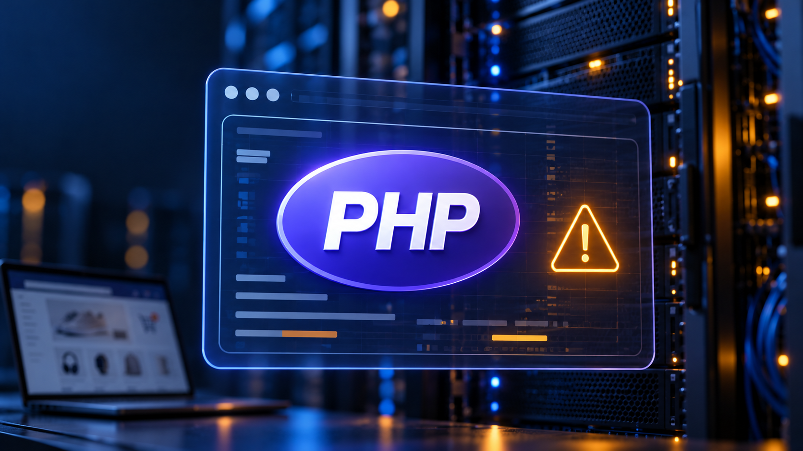
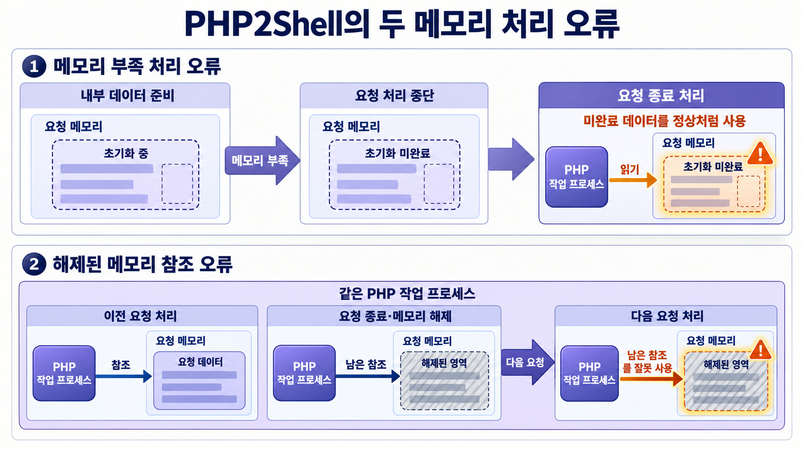
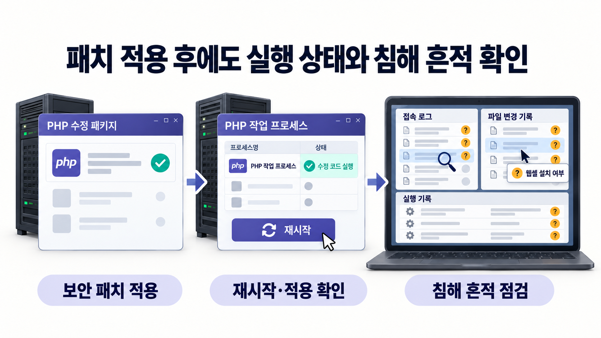

2026년 10월 21일 밤, 일본 **소니(Sony) 스토어**의 제품 구매 페이지와 장바구니, My Sony 계정 페이지 이용에 차질이 생겼다. 소니가 PHP 보안 취약점에 대응하기 위해 제품 정보 웹사이트와 스토어의 일부 서비스를 제한했기 때문이다. 

소니는 서비스를 안전하게 운영하기 위한 예방 조치였다고 설명했다. 이튿날인 **10월 22일 오후 7시 30분경** 점검을 마쳤다고 밝혔다. 시각은 한국과 같은 일본 현지 기준이다.

온라인 구매에까지 영향을 준 이번 문제는 **PHP2Shell로 불리는 두 취약점**이었다. 여러 웹사이트가 함께 사용하는 실행 환경에서 발견된 문제여서, 개별 서비스의 코드를 잘 관리하는 것만으로는 대응을 마칠 수 없었다. 

## 1. PHP2Shell, 무엇이 문제인가?

PHP는 서버에서 사용자의 요청을 처리해 웹페이지를 만드는 데 쓰이는 프로그래밍 언어다. 서버에는 이 코드를 실행하는 환경도 설치된다. 게시판과 쇼핑몰은 물론, WordPress, Drupal, Joomla 같은 웹사이트 제작 도구도 PHP를 사용한다.

**PHP2Shell은 이 실행 환경 자체에서 발견된 두 가지 치명적인 보안 취약점의 이름이다.** 두 문제는 요청을 처리하다 오류가 났을 때 PHP가 내부 데이터를 안전하게 다루지 못한다는 공통점이 있다.

- **CVE-2026-109618:** 메모리 부족으로 작업이 중단됐을 때, 사용할 준비가 끝나지 않은 데이터를 정상 데이터처럼 처리할 수 있는 문제다.
- **CVE-2026-109619:** 요청이 끝나 메모리가 해제된 뒤에도 이를 가리키는 정보가 남는 문제다. 같은 PHP 작업 프로세스가 다음 요청을 처리하면서 이미 해제된 메모리를 잘못 참조할 수 있다.

공격자는 이런 오류를 악용해 서버에서 자신이 준비한 코드를 실행할 수 있다. 이를 **원격 코드 실행(RCE)** 이라고 한다. 두 번째 취약점에서는 메모리에 있던 정보가 노출되는 문제도 확인됐다.

Apache 웹서버가 PHP를 직접 실행하는 `mod_php` 환경에서는 웹사이트에 로그인하거나 애플리케이션 코드가 실행되기 전에도 공격이 성립하는 사례가 검증됐다. **인증 없는 원격 코드 실행**이 가능했다는 뜻이다. 처음 확보하는 권한은 PHP를 실행하는 계정의 권한이며, 더 높은 권한을 얻거나 다른 시스템으로 이동하려면 별도의 조건이 필요할 수 있다.

실행 방식과 설정 등에 따라 공격 성공 조건은 달라진다. PHP 공식 보안 공지는 `mod_php`의 위험을 가장 높게 평가하면서도, **웹 요청을 처리하는 모든 PHP 설치 환경**을 점검 대상으로 안내했다. 

## 2. 왜 전 세계적인 보안 이슈가 되었을까?

**PHP를 공통 실행 환경으로 쓰는 웹사이트가 많아 여러 조직이 이번 취약점에 함께 대응해야 했다.**

웹 기술 통계 사이트 W3Techs에 따르면 2026년 10월 29일 기준, 서버 측 프로그래밍 언어를 식별할 수 있는 웹사이트 가운데 **69.2%가 PHP를 사용**하고 있다. 이는 사용 비중을 나타내는 통계이며, 취약하거나 해킹된 웹사이트의 비율은 아니다. 

애플리케이션이나 플러그인 자체의 취약점은 해당 코드를 수정하거나 업데이트해 해결한다. 그러나 PHP2Shell은 실행 환경의 문제였으므로, 웹사이트 프로그램을 최신으로 유지했더라도 PHP에 대한 별도 점검과 업데이트가 필요했다. 

조직들은 공격을 걸러내는 보호 기능을 배포하거나 서비스를 제한하며 수정 사항을 적용했다.

**Cloudflare**는 공식 공개 전에 PHP2Shell 공격을 탐지·차단하기 위한 웹 애플리케이션 방화벽(WAF) 보호 기능을 배포했다. WAF는 웹사이트로 오가는 통신에서 공격 징후를 걸러내는 보안 기능이다. 무료 요금제에도 보호 기능을 제공했지만, PHP 자체의 업데이트는 여전히 필요하다고 강조했다. 

**Wikimedia Foundation**은 10월 20일 Wikimedia Cloud Services와 일부 개발·운영 지원 서비스를 예방적으로 중단했다. 이곳에서는 개별 프로젝트 관리자가 각자의 소프트웨어를 관리한다. 재단이 위험을 인지했더라도 모든 실행 환경에 수정 사항이 적용됐는지 중앙에서 즉시 보장하기 어려웠다.

**Orange**는 10월 22일 발표에서 일부 웹사이트와 애플리케이션의 접근을 예방적으로 중단했으며, 보안 패치와 검증을 마친 뒤 순차적으로 복구한다고 설명했다. Wikimedia와 Orange의 발표는 공격을 예방하기 위한 조치로, 서비스 중단 자체가 침해 피해를 뜻하지는 않는다. [11, 12]

## 3. 실제로 공격과 피해가 발생했을까?

**공개 이전부터 악용 시도가 관측됐고, 공개 이후에는 실제 침해에 관한 분석도 발표됐다.**

Amazon의 보안 연구팀은 공격 관측용 시스템인 MadPot에서 **10월 17일 PHP2Shell 악용 시도**를 확인했다고 밝혔다. 공식 공개일인 10월 21일보다 나흘 앞선 시점이었다. 다만 AWS는 이 시도들이 실제 운영 환경에서 성공했을지는 불확실하다고 설명했다.

이후 미국 사이버보안·인프라보안국(CISA)은 **미국 현지 기준 10월 26일**, PHP2Shell의 두 취약점을 실제 악용이 확인된 취약점 목록인 KEV(Known Exploited Vulnerabilities)에 추가했다.

보다 구체적인 침해 분석은 보안기업 **Dream의 연구팀**이 10월 26일 공개했다. 연구팀은 공격자가 남긴 자료를 분석해 미국, 일본, 대만, 한국에 걸친 **방화벽 24대와 내부 방화벽 관리 서버 1대**, 총 25대가 장악된 정황을 확인했다고 보고했다.

공격은 **외부에 노출된 관리 화면으로 침입한 뒤 실행 권한을 높이고, 내부 관리 서버로 이동하는 흐름**이었다. 보고서는 PHP2Shell에 Linux의 권한 상승 취약점인 **Fragnesia(CVE-2026-46300)** 를 결합해 이런 접근을 확보했다고 분석했다.

Dream 보고서에 따르면 공격자는 한 미국 정부 관련 조직의 내부 관리 서버에서 인증정보를 추출하고 Active Directory의 사용자·그룹 정보를 수집했다. Active Directory는 조직의 계정과 접근 권한을 관리하는 시스템이다. 다만 공격자가 추가로 시도한 비밀번호 대입이나 백도어 계정 생성까지 성공했는지는 확인되지 않았다.

초기 침해 발표가 정정된 사례도 있다. **Palo Alto Networks의 Unit 42는 10월 25일**, 유럽 정부기관 침해 사건의 최초 접근이 PHP2Shell의 두 CVE와 연관됐는지 확인할 수 없다며 10월 23일 업데이트를 철회했다.

이처럼 실제 악용과 침해 보고는 존재하지만, 개별 보고의 범위를 구분해서 읽어야 한다. Dream이 분석한 25대는 특정 캠페인의 시스템 수이며 피해 기업 수가 아니다. **검토한 공개 자료만으로 전 세계 피해 조직 수나 정보 유출량, 금전적 손실의 총계를 확정하기는 어렵다.** [13, 14, 15, 16]

## 4. 우리나라는 어떤 영향을 받았을까?

과학기술정보통신부와 한국인터넷진흥원(KISA)은 10월 22일 낮 12시부터 민간 분야 사이버위기 경보를 기존 '관심'에서 **'주의' 단계로 상향**하고, PHP를 사용하는 기업과 기관에 즉시 업데이트를 권고했다. 정부는 대규모 해킹 가능성에 대한 선제 대응이라고 설명했다.

**카페24**는 10월 21일 오전부터 PHP의 파일 업로드 진행률 기능을 끄고, 이후 한 번에 올리는 파일 수와 입력 항목 수 등을 제한하는 조치를 공지했다. 이 과정에서 일부 웹사이트는 다중 파일 업로드나 입력 항목이 많은 양식의 저장에 제한을 받을 수 있었다. 같은 날 밤에는 PHP 8.2 이상 사용 서비스에 공식 보안 패치를 순차 적용하는 작업을 공지했다.

**가비아**는 웹호스팅의 PHP 버전별로 보안 업데이트와 완화 조치를 적용했다고 밝혔다. 지원 버전은 수정 버전으로 업데이트하고, 지원 종료 버전에는 기존 코드에 보안 수정을 반영한 백포트 패치 또는 완화 조치를 적용했다. 고객이 직접 서버를 운영하는 서버호스팅·클라우드 상품에는 고객의 업데이트가 필요하다고 안내했다.

안랩 ASEC은 10월 21일 인터넷 자산 검색 서비스에서 국내 PHP 사용 호스트가 **112,183건, 약 11만 건** 조회됐다고 설명했다. 이는 검색엔진이 PHP로 식별한 결과다.

Dream의 침해 분석에는 한국도 포함돼 있지만, 한국에서 장악된 시스템의 정확한 대수와 피해 조직명은 공개되지 않았다. 이 자료만으로 국내 전체 피해 규모를 추산하기는 어렵다.

국내 대응에서도 PHP를 누가 관리하느냐에 따라 조치 책임이 달랐다. 호스팅 업체가 대신 업데이트하는 서비스가 있는 반면, 운영자가 직접 수정 사항을 적용해야 하는 환경도 있었다.

## 5. 패치는 나왔는데, 왜 대응이 끝나지 않을까?

**운영자는 수정 사항이 실제 서비스에 적용됐는지, 적용 전에 침해가 발생한 흔적은 없는지 차례로 확인해야 한다.**

### 운영 환경에 맞는 수정본 적용

PHP 개발팀이 10월 21일 공개한 두 CVE의 최초 수정 버전은 다음과 같다.

| PHP 계열 | CVE-2026-109618·CVE-2026-109619 최초 수정 버전 |
| --- | --- |
| PHP 8.2 | 8.2.35 |
| PHP 8.3 | 8.3.36 |
| PHP 8.4 | 8.4.27 |
| PHP 8.5 | 8.5.12 |

운영 환경에 맞는 공급사의 수정 패키지를 확인해야 한다.

적용이 어려운 환경도 있다. **PHP 8.1 이하 버전은 PHP 개발팀의 정식 보안 지원이 종료된 상태**여서, 지원 중인 버전처럼 새 정식 릴리스를 설치하는 경로가 제공되지 않는다.

Ubuntu 같은 운영체제 공급사는 기존 버전에 보안 수정을 반영하는 **백포트(Backport)** 패키지를 제공한다. PHP 보안팀도 이번 대응을 위해 **PHP 7.4·8.0·8.1용 최소 소스 백포트**를 예외적으로 제공했다. 구버전의 정식 지원은 재개되지 않았지만, 일부 운영자는 이런 수정본을 이용할 수 있다.

유지 가능한 보안 수정 경로가 없다면 지원 버전으로 이전해야 한다. 이때 기존 애플리케이션이나 플러그인이 새 PHP 버전에서 정상적으로 동작하는지 검증하고, 필요하면 코드도 수정해야 한다.

### 실제 적용 여부 확인

보안기업 OX Security는 인터넷에 공개된 서버와 서비스를 검색하는 Shodan을 이용해 PHP 버전을 조사했다. 10월 26일 판정 대상 **1,990,772개 가운데 127,430개, 약 6.4%**를 수정 버전 사용 서비스로 분류했다.

이 비율은 조사 표본에 한정된다. 버전을 공개하지 않는 서비스는 판정 대상에서 제외됐고, 구버전 번호를 유지한 채 백포트가 적용됐는지도 외부 버전 정보만으로 판단하기 어렵다. 따라서 나머지 93.6%를 전 세계 서버의 취약 비율로 해석할 수는 없다.

운영자는 **공급사의 수정 패키지가 설치됐는지, 필요한 설정이 적용됐는지, PHP 작업 프로세스가 재시작돼 수정된 코드로 실행 중인지**를 확인해야 한다. 외부에서 보이는 버전 번호만으로는 이 상태를 모두 알 수 없다.

### 업데이트 전 침해 흔적 점검

공식 공개 전부터 악용 시도가 관측됐으므로 업데이트를 마친 뒤에도 과거 노출 기간을 살펴봐야 한다. 비정상적인 접근과 프로그램 실행, 예상하지 못한 파일 변경, 서버를 원격으로 조종하는 웹셸의 설치 흔적 등을 점검해야 한다. 패치는 취약점을 막지만, 이미 공격자가 남긴 접근 수단까지 제거해 주지는 않는다.

## 6. PHP2Shell이 남긴 과제

웹사이트가 안전하게 작동하려면 구매 기능의 코드뿐 아니라 이를 실행하는 PHP에도 문제가 없어야 한다. 소니 스토어에서는 PHP 취약점에 대응한 긴급 점검이 제품 정보 확인과 구매, 계정 이용에까지 영향을 미쳤다.

수정본이 나온 뒤에도 할 일은 남는다. 운영 환경마다 적용 방법과 관리 주체가 다르다. **운영자는 수정 사항을 실제 서비스에 적용하고, 업데이트 전에 침해가 발생한 흔적도 살펴야 한다. 침해 흔적이 발견되면 그에 따른 대응도 필요하다.**

---

## 출처

1. 소니 — 10월 21일 밤부터의 긴급 시스템 점검 및 일부 서비스 중단에 관한 공식 공지 — 10월 23일 게시. PHP 취약점에 대한 예방 조치로 10월 22일 오후 7시 30분경 점검을 완료했다고 설명한다. 정확한 시작 시각이 없어 최초 PHP 수정판 공개 전 중단 여부는 확정할 수 없다. 시각은 한국과 같은 일본 현지 기준이다. (https://www.sony.jp/msc/info/20261023/)
2. 소니 판매점 Kunkoku — 소니 스토어 기능 복구 관측 기록 — 제품 정보·스토어의 점검 안내와 구매 페이지·장바구니·My Sony 계정 페이지의 이용 차질 및 복구에 관한 현장 기록. (https://kunkoku.jp/sonystore-maintenance-202610-2.html)
3. PHP — 2026년 공식 공지 — 10월 21일 두 취약점의 보안 권고와 구버전 소스 백포트. (https://www.php.net/archive/2026.php#2026-10-21-5)
4. PHP — CVE-2026-109618 기술 권고 — 메모리 부족 처리 문제, 영향과 수정 버전. (https://github.com/php/php-src/security/advisories/GHSA-w8hw-w9fx-j79w)
5. PHP — CVE-2026-109619 기술 권고 — 요청 간 내부 상태 잔존, 악용 조건과 수정 버전. (https://github.com/php/php-src/security/advisories/GHSA-6wmf-4rv5-p3rp)
6. WordPress — 공식 실행 요구사항 — PHP 사용과 실행 조건. (https://wordpress.org/about/requirements/)
7. Drupal — PHP 요구사항 — PHP 사용과 버전별 요구사항. (https://www.drupal.org/docs/getting-started/system-requirements/php-requirements)
8. Joomla — 기술 요구사항 — PHP 사용과 실행 조건. (https://manual.joomla.org/docs/next/get-started/technical-requirements/)
9. W3Techs — PHP 사용 통계 — 2026년 10월 29일 PHP 사용 비율과 통계의 분모. (https://w3techs.com/technologies/details/pl-php)
10. Cloudflare — PHP2Shell에 대한 WAF 보호 배포 — 공개 전 보호 배포, 무료 요금제 포함 범위와 업데이트 권고. (https://blog.cloudflare.com/php-vulnerabilities-waf-protection/)
11. Wikimedia Foundation — PHP 취약점이 Wikimedia Cloud Services에 미친 영향 — 중단 대상, 분산 관리 구조와 복구 조건. (https://diff.wikimedia.org/2026/10/21/impact-of-php-vulnerabilities-on-wikimedia-cloud-services/)
12. Orange — PHP를 사용하는 일부 웹사이트와 애플리케이션의 일시적 접근 중단 — 예방적 중단과 순차 복구 방침. (https://newsroom.orange.com/orange-suspend-temporairement-lacces-a-certains-sites-et-applications-utilisant-php-514804/?lang=eng)
13. AWS — MadPot에서 관측한 공개 전 PHP2Shell 악용 시도 — 10월 17일 관측, 성공 여부의 불확실성, 침해 흔적 점검 권고. (https://aws.amazon.com/blogs/security/amazon-threat-intelligence-identifies-php2shell-exploitation-prior-to-public-disclosure-in-madpot/)
14. CISA — 두 취약점의 KEV 등재 공지 — 미국 현지 10월 26일 두 CVE의 등재. (https://content.govdelivery.com/accounts/USDHSCISA/bulletins/4309083)
15. Dream Research — PHP2Shell과 권한 상승 취약점을 연계한 시스템 25대 침해 분석 — 분석된 시스템 수, 국가, 공격 경로와 확인되지 않은 후속 결과. (https://dreamgroup.com/blog/chained-php2shell-exploit-roots-25-servers)
16. Unit 42 — PHP 취약점 위협 브리핑과 10월 25일 정정 — 유럽 정부기관 침해와 PHP2Shell의 연관성 주장 철회. (https://unit42.paloaltonetworks.com/cve-2026-109618-cve-2026-109619/)
17. 대한민국 정책브리핑 — PHP 긴급 업데이트 권고와 사이버위기 경보 상향 — 경보 상향 시각과 국내 대응 수칙. (https://www.korea.kr/news/policyNewsView.do?newsId=148974113)
18. 카페24 — 10월 21일 PHP 취약점 최초 조치 — 오전 11시 30분부터 진행한 업로드 진행률 기능 비활성화. (https://help.cafe24.com/notice/system-notice/20261021_php-security-emergency/)
19. 카페24 — 10월 21일 PHP 취약점 추가 조치 — 업로드·입력 제한과 서비스 영향. (https://help.cafe24.com/notice/system-notice/20261021_php-security-additional/)
20. 카페24 — PHP 공식 보안 패치 적용 공지 — 10월 21일 오후 11시 30분부터의 패치 작업. (https://help.cafe24.com/notice/system-notice/20261023_php-security-official-patch/)
21. 가비아 — PHP 취약점 긴급 조치와 고객 확인 사항 — 버전별 업데이트·백포트·완화 조치 및 고객 관리 책임. (https://www.gabia.com/gabia_notice/view.php?seq_no=45924)
22. 안랩 ASEC — 국내 PHP 서버 약 11만 개의 집계 방법 — 112,183건의 의미와 통계 해석의 한계. (https://asec.ahnlab.com/ko/95982/)
23. PHP — 공식 지원 버전과 지원 기간 — 정식 지원 범위와 지원 종료의 의미. (https://www.php.net/supported-versions.php)
24. Ubuntu — PHP 보안 공지 USN-8948-1 — PHP 8.1 등을 포함한 배포판 수정 패키지. (https://ubuntu.com/security/notices/USN-8948-1)
25. OX Security — 공개 5일 후 PHP2Shell 패치 적용 조사 — Shodan 기반 분류 방법, 판정 대상과 수정 버전 비율. (https://www.ox.security/blog/php2shell-day-5-the-panic-hasnt-turned-into-patching/)
