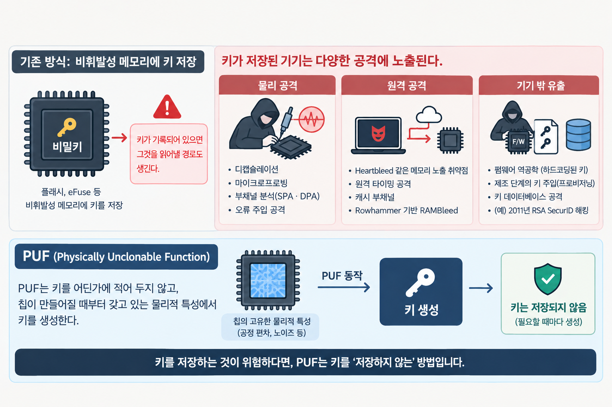

## 비밀키를 어디에 둘 것인가

암호 기술은 결국 비밀키 하나를 지키는 일이다. 알고리즘이 아무리 튼튼해도 키가 새어 나가면 그 기기의 보안은 끝난다.

그동안 대부분의 기기는 비밀키를 플래시같은 비휘발성 메모리에 저장해 왔다. 하지만 키가 기록돼 있으면 그것을 읽어낼 경로도 생긴다.

- **물리 공격**: 기기를 확보한 공격자는 디캡슐레이션, 마이크로프로빙, 부채널 분석(SPA·DPA), 오류 주입 공격으로 저장된 키를 노린다
- **원격 공격**: Heartbleed 같은 메모리 노출 취약점, 원격 타이밍 공격, 캐시 부채널, Rowhammer 기반 RAMBleed처럼 기기를 만지지 않고도 키를 빼내는 방법이 보고돼 왔다
- **기기 밖 유출**: 펌웨어 역공학으로 하드코딩된 키가 드러나거나, 제조 단계의 키 주입(프로비저닝) 과정과 키 데이터베이스가 공격받을 수 있다. 2011년 RSA SecurID 해킹이 대표적이다

PUF(Physically Unclonable Function, 물리적 복제 방지 기능)는 이 문제를 거꾸로 푼다. 키를 어딘가에 적어 두지 않고, 칩이 만들어질 때부터 갖고 있는 물리적 특성에서 그때그때 키를 만들어낸다.

## 같은 설계로 만들어도 각 칩은 고유하다

반도체는 같은 설계도, 같은 공정으로 찍어내도 완전히 똑같지 않다. 트랜지스터가 켜지는 전압, 배선의 굵기, 층과 층을 잇는 구멍의 모양이 나노미터 단위에서 조금씩 달라진다. 이 차이는 제조사도 통제할 수 없고, 일부러 똑같이 만들 수도 없다.

PUF는 이 오차를 활용한다. 칩에 어떤 입력(챌린지)을 주면 그 칩만의 고유한 출력(응답)이 나온다. 같은 칩은 같은 입력에 거의 같은 답을 내고, 다른 칩은 같은 입력에도 전혀 다른 답을 낸다. 일란성 쌍둥이도 지문은 다른 것처럼, 같은 웨이퍼에서 나온 칩도 PUF 응답은 서로 다르다.

PUF가 쓸모 있으려면 세 가지가 필요하다.

- **고유성**: 칩마다 응답이 충분히 달라야 한다.
- **재현성**: 같은 칩은 여러 번 측정해도 같은 응답을 내야 한다.
- **복제 불가능성**: 응답을 알아도 그 응답을 내는 칩을 새로 만들 수 없어야 한다.

## PUF의 종류

PUF는 어떤 물리적 차이를 이용하느냐에 따라 여러 종류로 나뉜다.

**SRAM PUF**는 가장 널리 쓰이는 방식이다. SRAM 셀은 두 개의 인버터가 서로 맞물린 구조인데, 전원을 켠 직후에는 값이 정해져 있지 않다. 이때 양쪽 트랜지스터의 미세한 세기 차이 때문에 셀마다 0 또는 1 중 한쪽으로 기우는 경향이 생긴다. 이 초기값 패턴이 칩의 지문이 된다. 대부분의 칩에 이미 SRAM이 들어 있어 별도 회로 없이 구현할 수 있다는 것이 장점이다.

**아비터(Arbiter) PUF**는 두 신호를 똑같이 설계된 두 경로로 동시에 출발시키고, 어느 쪽이 먼저 도착하는지로 0과 1을 정한다. 설계상 동시에 도착해야 하지만 실제로는 제조 오차 때문에 칩마다 승자가 다르다.

**링 오실레이터(RO) PUF**는 같은 설계의 발진 회로 여러 개를 두고, 각 회로의 미세한 주파수 차이를 비교해 비트를 만든다.

**VIA PUF**는 공정 중 층과 층을 연결하는 비아(VIA) 구멍이 제대로 뚫리는지 아닌지의 무작위성을 이용한다. 국내 기업 ICTK가 이 방식으로 보안칩을 상용화했다.

PUF는 입력과 출력 쌍의 개수에 따라 나누기도 한다. SRAM PUF처럼 쌍이 적은 '약한(weak) PUF'는 주로 키 생성에, 아비터 PUF처럼 쌍이 아주 많은 '강한(strong) PUF'는 기기 인증에 쓰인다.

## 비트플립이 발생하면 어떡하나요?

PUF 응답은 완벽하게 일정하지 않다. 온도나 전압이 바뀌거나 칩이 오래 쓰이면 일부 비트가 뒤집힌다. SRAM PUF라면 매번 같은 값으로 켜지는 셀도 있지만, 0과 1 사이를 오가는 불안정한 셀도 섞여 있다. 그런데 암호키는 한 비트만 달라져도 쓸 수 없다.

그래서 PUF로 키를 만들 때는 두 단계를 거친다.

1. **등록(enrollment)**: 제조 단계에서 PUF 응답을 측정해 키를 정하고, 나중에 같은 키를 복원하는 데 필요한 '헬퍼 데이터'를 만들어 저장한다
2. **복원(reconstruction)**: 키가 필요할 때마다 PUF를 다시 측정하고, 헬퍼 데이터와 오류정정 부호로 뒤집힌 비트를 바로잡아 등록 당시와 똑같은 키를 만든다

이런 구조를 퍼지 추출기(fuzzy extractor)라고 부른다. 헬퍼 데이터는 저장해 두는 값이지만, 이것만으로는 키를 알아낼 수 없도록 설계된다. 비밀은 여전히 칩의 물리 구조 안에만 있다.

오류정정 부담을 줄이기 위해 등록 단계에서 응답을 여러 번 측정하고, 항상 같은 값을 내는 안정적인 셀만 골라 쓰는 방법도 함께 쓰인다. 셀을 얼마나 엄격하게 고르느냐가 키 생성 실패율과 직결되기 때문에 이 부분은 지금도 활발히 연구되고 있다.

## 연구실에서 일상 기기로

PUF 개념은 2000년대 초 미국 MIT 연구진에게서 나왔다. 처음에는 빛을 산란시키는 소재에 레이저를 비춰 생기는 무늬를 고유값으로 쓰는 광학 방식이 제안됐고, 곧이어 칩 안의 회로 지연 차이를 이용하는 실리콘 PUF가 발표됐다. 아비터 PUF와 링 오실레이터 PUF가 이 시기에 차례로 등장했다.

2007년 무렵 SRAM의 전원 인가 초기값을 이용하는 SRAM PUF가 제안되면서 큰 전환점을 맞았다. 새 회로를 설계하지 않고 이미 칩에 있는 메모리로 PUF를 만들 수 있게 되자 산업계의 관심이 커졌고, SRAM PUF를 상용 기술로 제공하는 기업들이 생겨났다.

약점도 함께 드러났다. 2010년 전후로, 강한 PUF의 입력-출력 쌍을 충분히 모으면 머신러닝으로 그 동작을 흉내 내는 모델을 만들 수 있다는 연구가 잇따랐다. 이 때문에 오늘날 상용 제품은 PUF 응답을 밖으로 그대로 내보내지 않고, 칩 내부에서 키를 만드는 용도로 주로 쓴다.

지금 PUF는 '신뢰점(Root of Trust)'의 핵심 부품으로 자리 잡았다. 신뢰점은 기기가 켜질 때 가장 먼저 믿고 출발하는 하드웨어 기반 보안 요소다. 여러 반도체 기업이 마이크로컨트롤러와 FPGA에 PUF를 내장해 펌웨어 검증(시큐어 부트), 설정 데이터 암호화, 기기 인증에 활용하고 있다. 국내에서도 PUF 기반 보안칩이 eSIM과 IoT 기기 등에 적용되고 있다. PUF의 보안 요구사항과 평가 방법은 국제표준 ISO/IEC 20897로 정리됐다.

최근에는 PUF와 양자내성암호(PQC)를 결합하는 흐름도 나타나고 있다. PUF가 칩 고유의 키를 안전하게 만들고 보관하면, 양자내성암호 알고리즘이 그 키로 양자컴퓨터 시대에도 안전한 서명과 키 교환을 수행하는 구조다.

## PUF의 한계

PUF의 가장 큰 장점은 키를 어디에도 적어 두지 않는다는 점이다. 전원이 꺼진 칩 안에는 키가 존재하지 않고, 켜지는 순간 물리 구조에서 다시 만들어진다. 칩을 해체해 메모리를 읽어도 나오는 것은 헬퍼 데이터뿐이다. 칩을 복제하려면 나노 단위의 제조 오차까지 똑같이 재현해야 하는데, 이는 제조사 자신도 할 수 없는 일이다.

그렇다고 PUF만 넣으면 안전해지는 것은 아니다. 고려할 점은 다음과 같다.

- **신뢰성**: 극한 온도·전압이나 장기간 사용으로 응답이 크게 흔들리면 키 복원에 실패할 수 있다. 오류정정과 안정적인 셀 선별을 함께 설계해야 한다
- **모델링 공격**: 입력-출력 쌍이 노출되는 구조는 머신러닝으로 동작을 예측당할 수 있다
- **부채널 공격**: 키를 복원하는 순간의 전력 소비나 전자파를 분석해 키를 알아내려는 시도가 있을 수 있다
- **헬퍼 데이터 관리**: 헬퍼 데이터가 변조되면 키 복원이 실패하거나 정보가 새어 나갈 수 있어, 무결성을 보호하는 장치가 필요하다

결국 PUF는 '키를 안전하게 만들고 숨기는' 문제를 해결하는 부품이다. 그 키를 쓰는 암호 구현, 펌웨어, 통신 프로토콜까지 함께 설계해야 기기 전체의 보안이 완성된다.

## 참고자료 및 출처

1. [Sensors, Physical Unclonable Functions in the Internet of Things: State of the Art and Open Challenges (2019)](https://www.ncbi.nlm.nih.gov/pmc/articles/PMC6679326/) — PUF의 기본 개념, 약한·강한 PUF 구분, 등록·인증 절차와 위협
2. [Sensors, Intrinsic Physical Unclonable Function (PUF) Sensors in Commodity Devices (2019)](https://www.ncbi.nlm.nih.gov/pmc/articles/PMC6603541/) — 광학 PUF부터 아비터·RO·SRAM PUF까지의 발전 흐름
3. [ICTK, PUF 기술 소개](http://www.ictk.co.kr/kr/servicenproduct/puf) — 챌린지-응답 원리와 PUF 기반 키 관리 방식
4. [보안뉴스, ICTK 보안칩, KCMVP 인증 획득 (2022.7.13)](https://m.boannews.com/html/detail.html?idx=108296) — 국내 PUF 보안칩 인증 사례와 ISO/IEC 20897 표준 등재
