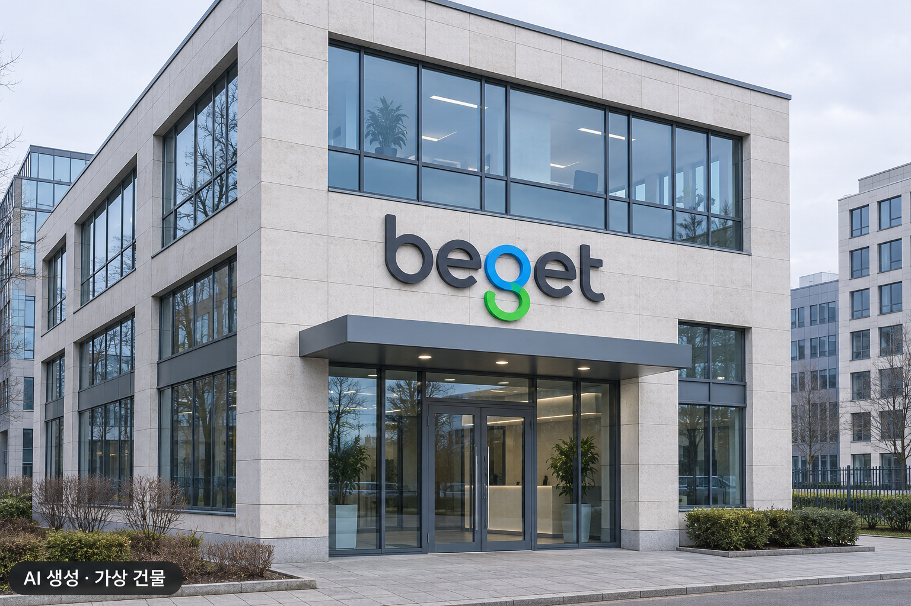
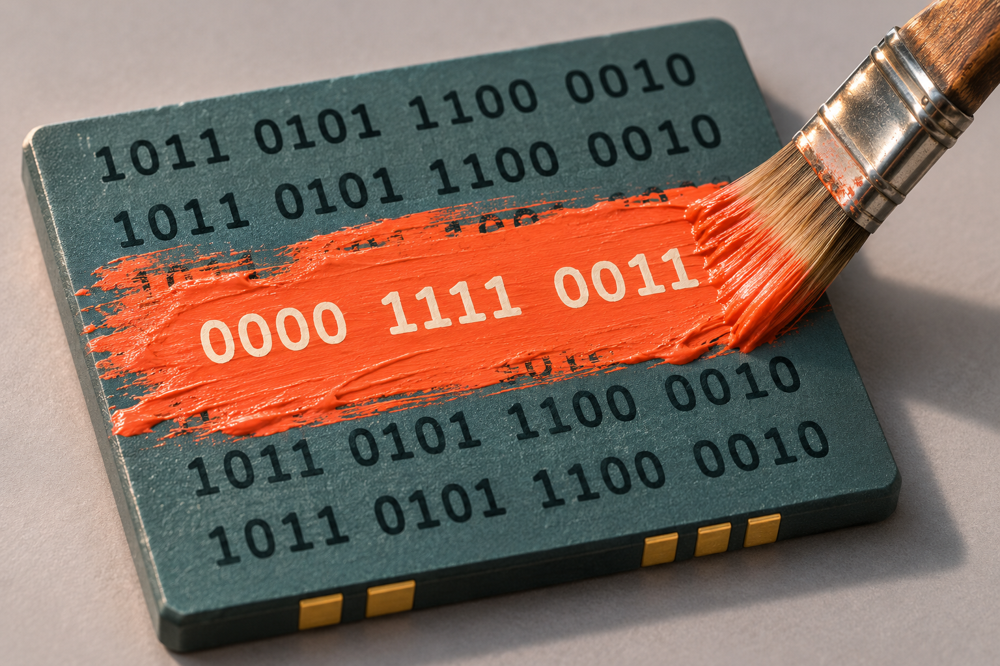
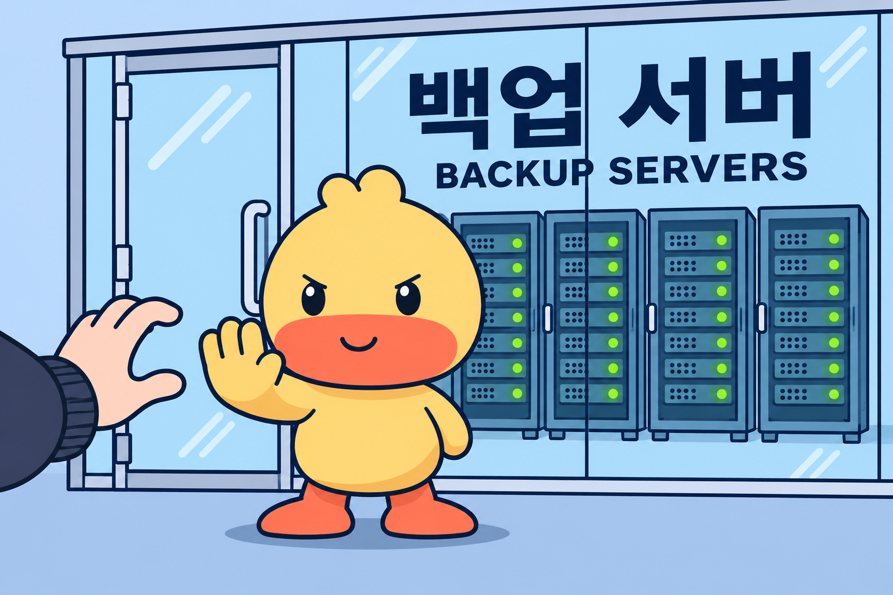

러시아 클라우드·호스팅 업체 Beget이 데이터 삭제 공격을 받아 서버와 웹사이트 복구에 나섰다. 회사 발표에 따르면 공격자는 한국 시간으로 2026년 11월 2일 오전 8시경 관리 서버에 접근한 것으로 추정된다. 오전 8시 30분에는 서버 데이터를 삭제하는 악성코드를 실행했다. Beget은 확산을 막기 위해 오전 8시 55분 모든 서버의 네트워크 연결을 끊었다.

복구 작업은 11월 12일에도 이어졌다. Beget은 이날 오전 2시 기준으로 공유 호스팅 웹사이트 5만 5천 개를 넘게 백업에서 복원했다고 밝혔다. 공유 호스팅은 여러 고객이 한 서버를 나눠 쓰는 서비스이며, 이 수치는 회사가 집계한 웹사이트 복구 건수다.

*AI로 재구성한 Beget 로고 이미지.*

이처럼 데이터 파괴를 목적으로 사용하는 악성코드를 와이퍼(Wiper)라고 한다. 공격자가 확보한 권한으로 파일 내용이나 저장장치의 논리 구조를 훼손해 컴퓨터와 서비스를 사용할 수 없게 만들 수 있다. Beget은 공격자가 관리 서버에 접근해 데이터 삭제용 악성코드를 실행했다고 밝혔다. 구체적인 악성코드 이름과 삭제 방식은 해당 공지에 제시되지 않았다.

## 파일 내용과 저장장치 구조를 망가뜨린다

파일 내용을 덮어쓰면 원래 정보를 되찾기 어려워진다. 와이퍼는 문서나 데이터베이스에 들어 있는 값을 다른 값으로 바꿔 내용을 훼손할 수 있다. 이는 책의 글자를 엉뚱한 글자로 덮는 것과 비슷하다. 파일 이름이 그대로여도 내용의 일부나 전부를 정상적으로 읽지 못할 수 있다.

*기존 값을 덮어쓰는 원리를 물감으로 표현한 AI 생성 개념 이미지.*

원래 데이터가 얼마나 남아 있는지에 따라 복구 가능성이 달라진다. 파일을 삭제할 때 파일의 위치를 가리키는 정보만 없애고 내용은 남겨 두는 경우가 있다. 이때는 남은 내용을 찾아 복구가 가능할 수도 있다. 그러나 덮어쓰기로 원래 값이 사라진 부분은 이런 방식으로 되살리기 어렵다. 그래서 실제 복구 범위는 저장장치의 특성과 손상 방식에 따라 달라진다.

만약 저장장치의 구조를 손상시키면 컴퓨터의 부팅이나 데이터 접근을 막을 수 있다. 운영체제를 시작하는 데 필요한 정보나 저장 공간의 구분 정보를 망가뜨리는 방식이다. 서비스에 필요한 파일을 읽지 못하면 해당 서비스가 중단될 수 있다. 복구할 때는 파일 내용과 저장장치 구조의 손상 범위를 각각 살펴야 한다.

와이퍼는 암호화를 이용해 데이터를 영구적으로 읽지 못하게 만들 수도 있다. 공격자가 데이터를 암호화한 뒤 복호화 키를 남기지 않는 방식이다. 암호화형 랜섬웨어도 암호화 기술을 사용하지만, 일반적으로 복호화 수단을 제공하는 대가로 돈을 요구한다.

## 백업까지 손상되면 복구할 사본을 잃는다

와이퍼가 남긴 피해를 수습하려면 공격을 멈춘 뒤 손상된 데이터를 복구해야 한다. 악성코드의 실행을 차단하면 추가 파괴를 줄일 수 있지만, 이미 덮어쓴 파일의 원래 내용은 별도로 되찾아야 한다. 이때 살아남은 백업이 복구의 바탕이 된다.

공격자가 원본과 백업을 수정·삭제할 권한까지 확보하면 양쪽을 함께 잃을 수 있다. 예를 들어 운영 계정에 원본과 백업의 삭제 권한이 모두 있고 별도의 삭제 방지 설정도 없다면, 그 계정을 빼앗은 공격자는 양쪽 데이터를 지울 수 있다. 같은 서버의 다른 폴더에 복사해 둔 파일도 공격자의 접근 범위에 들어갈 수 있다.

복구 기능 자체를 끄는 공격도 있다. 공격자는 특정 시점의 상태를 보관한 스냅샷을 삭제해 기존 복구 지점을 없앤다. 백업 정책을 비활성화하면 새 사본이 만들어지는 것을 막을 수 있다. MITRE는 이를 ‘시스템 복구 방해’로 분류한다. 데이터 파괴에 이런 행위가 더해지면 피해자는 복구에 쓸 사본부터 다시 찾아야 한다.

## 접근과 삭제를 제한하여 백업을 보호하자

백업을 보호하려면 운영 시스템에서 행사할 수 있는 권한을 제한해야 한다. 운영 계정에 백업 삭제나 보존 기간 변경 권한이 있는지 확인하고, 백업 관리 권한을 별도로 둔다. 계정을 나눈 뒤에도 같은 상위 관리자 권한으로 양쪽을 모두 통제할 수 있는지 살펴야 한다. 이는 접근 가능한 백업을 함께 파괴하는 공격에 대비한 것이다.

*백업에 대한 접근 제한을 표현한 AI 생성 개념 이미지.*

오프라인 백업은 백업 사본을 네트워크에서 분리해 보관하는 방법이다. 평소 접근할 수 없는 곳에 데이터를 보관하면 서버를 장악한 공격자가 그 사본까지 지우기 어려워진다. CISA 등의 공동 대응 가이드도 오프라인 백업과 정기적인 복원 시험을 권고한다. 사본을 주기적으로 갱신하고, 복구가 필요할 때 꺼내 쓸 절차도 마련해야 한다.

불변 백업은 보존 설정에 따라 사본의 수정과 삭제를 제한하는 방식이다. 관리자는 보호할 사본과 보존 기간을 정하고, 삭제 제한을 우회할 수 있는 권한이 누구에게 있는지 확인해야 한다.

백업 보존 기간은 사고를 발견하고 복구에 들어가기까지 걸릴 시간을 고려해 정해야 한다. 보존 기간이 끝나고 다른 보호 설정도 없다면 사본을 삭제할 수 있다. 저장량과 보관 기간에 따라 요금을 내는 환경에서는 보존 기간을 늘릴 때 비용도 커질 수 있다.

## 복원 시험으로 데이터와 서비스 상태를 확인한다

복원 시험은 데이터가 정상이며 실제 업무에 쓸 수 있는지 확인하는 작업이다. 손상된 데이터를 백업하면 그 사본에도 손상이 남기 때문이다. 그래서 운영망과 분리한 환경에서 백업을 복원하고 로그인, 조회, 저장 같은 핵심 기능을 실행해 본다. 가령 쇼핑몰이라면 상품 사진을 복원한 뒤 주문 내역이 온전히 남아 있는지, 새 주문을 저장할 수 있는지까지 확인하는 식이다. NIST도 복구한 데이터의 정확성·완전성과 악성코드가 없는 상태를 강조한다.

시험 결과에는 복원에 걸린 시간과 되찾지 못한 데이터의 범위를 기록한다. 백업 시점 이후의 주문이 빠졌다면 그 기간의 자료를 어디서 확보할지 정해야 하고, 복원이 너무 오래 걸렸다면 업무 재개 순서를 조정해야 한다. 이런 시험을 통해 백업 주기와 복구 절차를 고쳐 나갈 수 있다.

---

## 출처

- Beget, 「Recovery in progress — Timeline of events」 (https://beget.com/en/about)
- MITRE ATT&CK, 「Data Destruction — T1485」 (https://attack.mitre.org/techniques/T1485/)
- MITRE ATT&CK, 「Disk Wipe — T1561」 (https://attack.mitre.org/techniques/T1561/)
- MITRE ATT&CK, 「Data Encrypted for Impact — T1486」 (https://attack.mitre.org/techniques/T1486/)
- MITRE ATT&CK, 「Inhibit System Recovery — T1490」 (https://attack.mitre.org/techniques/T1490/)
- AWS, 「Locking objects with Object Lock」 (https://docs.aws.amazon.com/AmazonS3/latest/userguide/object-lock.html)
- NIST NCCoE, 「Data Integrity: Recovering from Ransomware and Other Destructive Events」 (https://www.nccoe.nist.gov/data-integrity-recovering-ransomware-and-other-destructive-events)
- CISA·MS-ISAC·NSA·FBI, 「#StopRansomware Guide」, 2023년 5월 (https://www.ic3.gov/CSA/2023/230523.pdf)
- FBI, 「Ransomware」 (https://www.fbi.gov/how-we-can-help-you/common-frauds-and-scams/ransomware)
- AWS, 「What is Web Hosting?」 (https://aws.amazon.com/what-is/web-hosting/)
- MITRE ATT&CK, 「Disk Structure Wipe — T1561.002」 (https://attack.mitre.org/techniques/T1561/002/)
- AWS, 「Amazon S3 pricing」 (https://aws.amazon.com/s3/pricing/)
