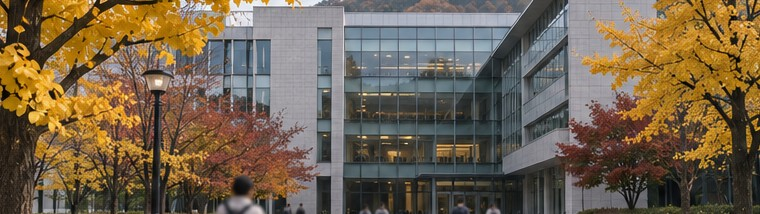
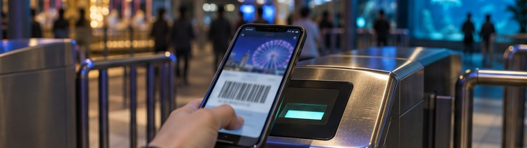

## 1. 우리 학교도? 대학 연구행정 자료 탈취 주장

공격자는 국내 대학의 자료를 탈취했다고 주장하며 압축파일 31개를 유포했다. 다크넷즈가 대학 이름으로 나눈 폴더 28개를 분석한 결과, 17개에 대학 산학협력단이 연구비와 회계를 관리하는 데 쓰는 rERP 관련 자료가 들어 있었다. 다크넷즈는 유포된 파이썬 코드에서 AI 도구 ARTEX와 관련된 경로 문자열도 찾았다.

[참고 · 보안뉴스의 대학 rERP 자료 분석 보도](https://www.boannews.com/news/articleView.html?idxno=147326)

## 2. 오라클, Java4Shell 보안 패치 공개

오라클은 11월 17일 Java4Shell 취약점(CVE-2026-114938)을 수정하는 보안 패치를 공개했다. 이 취약점은 일부 Oracle Java SE와 GraalVM에 영향을 주며, 공격자가 인증 없이 원격으로 코드를 실행할 수 있다. 오라클은 위험도를 CVSS 8.1점으로 평가했다.

[참고 · 오라클 2026년 11월 보안 업데이트 권고](https://www.oracle.com/security-alerts/cspunov2026.html)

## 3. BBC·CNN·Zoom까지 번진 Optimizely 공급망 공격

웹사이트 실험 도구 Optimizely가 제공하는 스크립트에 악성 코드가 섞이면서 방문자의 브라우저까지 코드가 전달됐다. Report URI는 11월 16일 BBC·CNN·Zoom 등 178개 조직이 쓰던 스크립트 188개에서 악성 코드를 찾았다. 공격자는 결제 카드 정보와 암호화폐를 노렸고, 분석팀은 공격자 지갑으로 암호화폐가 넘어간 거래 기록도 찾아냈다.

[참고 · Report URI의 Optimizely 공급망 공격 분석](https://report-uri.ghost.io/worlds-largest-brands-infected-with-malware-via-optimizely/)

## 4. 더존비즈온 사고 여파, 한국전자인증 등 4곳 추가

보안뉴스는 11월 19일 더존비즈온 침해사고 여파로 한국전자인증, 곡성군미래교육재단, 광주연구원, 광주여성재단에서도 개인정보가 유출됐을 가능성을 보도했다. 보도에 오른 정보에는 한국전자인증 임직원·퇴직자의 연락처와 계좌번호, 광주연구원이 백업한 주소와 소득정보가 포함됐다. 4곳 모두 관계 기관에 신고했다.

[참고 · 보안뉴스의 더존비즈온 사고 11월 19일 보도](https://www.boannews.com/news/articleView.html?idxno=147382)

## 5. 레고랜드·씨라이프 부산 연간이용권 정보 조회

레고랜드 코리아와 씨라이프 부산은 외부인이 Accesso 예약 시스템에 무단으로 접근해 일부 연간이용권 고객 정보를 조회했다고 공지했다. 두 곳이 밝힌 조회 항목에는 이름, 주소, 이메일, 전화번호와 이용권 바코드 번호가 포함됐다. 고객 생년월일은 시스템에 암호화된 상태로 저장돼 있었다.

[참고 · TSN의 Accesso 예약 시스템 침해 보도](https://tsnmedia.org/accesso-legoland-korea-sealife-breach/)
